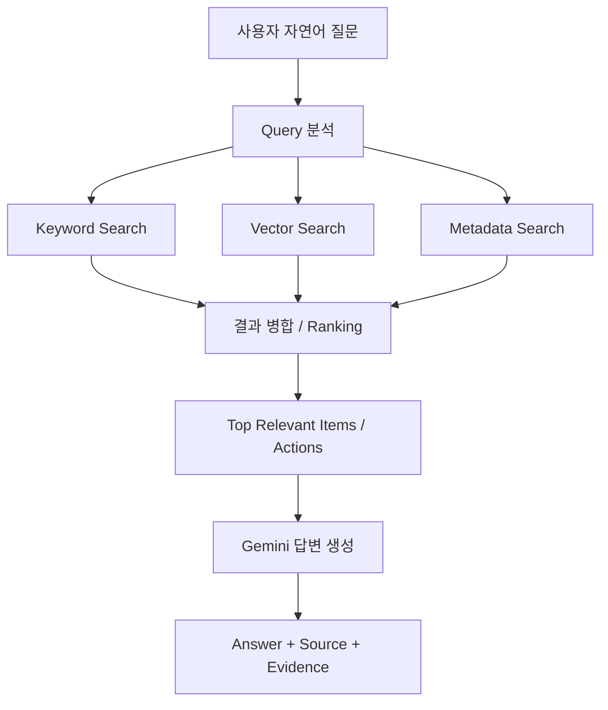
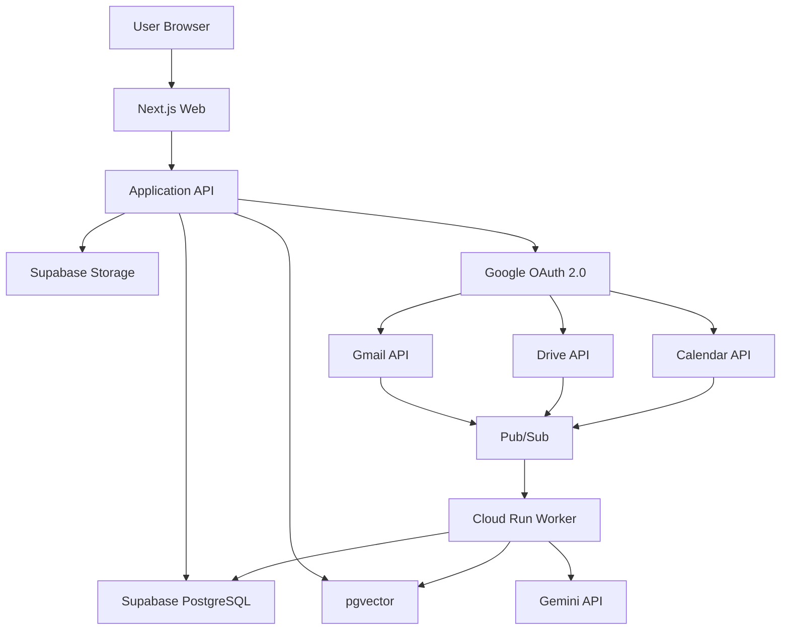
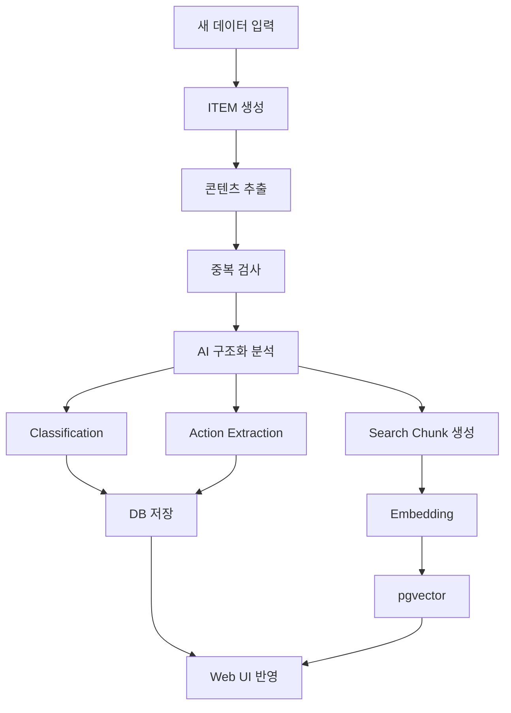

# 🧠 AI 통합 정보 허브

> Gmail·Google Drive·Google Calendar와 사용자가 직접 올린 PDF·이미지·스크린샷 등의 정보를 한곳에 모아, AI가 자동 분류·통합검색하고 문서 속 해야 할 일과 마감일을 찾아 D-Day로 관리해주는 웹 서비스입니다.

> **현재 프로젝트명은 작업명입니다. 최종 서비스명은 추후 확정합니다.**

---

## 1. Overview

AI 통합 정보 허브는 여러 서비스와 파일에 흩어진 개인 정보를 하나의 정보 단위로 통합해 관리하는 **개인 AI 정보 허브**입니다.

사용자는 메일, 파일, 일정, 캡처 등의 위치를 일일이 기억하거나 직접 분류할 필요 없이 필요한 정보를 자연어로 찾고, 문서와 메일에 포함된 신청·제출·납부·확인 업무와 마감일을 놓치지 않도록 관리할 수 있습니다.

### 해결하려는 문제

- Gmail, Drive, Calendar, PDF, 이미지, 캡처 등 정보가 여러 위치에 분산되어 있음
- 파일명이나 메일 제목을 정확히 기억하지 못하면 다시 찾기 어려움
- 공고문·메일을 읽고도 신청·제출·납부·갱신 등의 실제 행동을 놓칠 수 있음
- 사용자가 직접 분류하고 마감일을 정리해야 함

---

## 2. Core Concept — COLLECT · FIND · ACT

### 📥 COLLECT
정보를 모읍니다.

**자동수집**
- Gmail
- Google Drive
- Google Calendar

**직접입력**
- PDF
- 이미지
- 스크린샷
- 일반 문서
- 텍스트
- 클립보드 붙여넣기

### 🔎 FIND
AI가 분류하고 찾아줍니다.

- AI 자동분류
- Keyword Search
- Vector Search
- Metadata Search
- 자연어 통합검색
- Answer + Source + Evidence

### ✅ ACT
해야 할 일을 놓치지 않게 합니다.

- Action 자동추출
- Deadline 추출
- Requirements / Conditions 추출
- D-Day 관리
- 마감일 확인 필요 상태 관리
- 여러 Source에서 발견된 동일 Action 병합

---

## 3. v1 Scope

### 포함 범위

- Gmail 자동수집
- Google Drive 자동수집
- Google Calendar 자동수집
- PDF·이미지·스크린샷·문서·텍스트 직접입력
- AI 자동분류
- 자연어 통합검색
- Action 추출
- D-Day 관리
- Source / Evidence 표시

### 제외 범위

v1에서는 아래 기능을 개발하지 않습니다.

- SMS·카카오톡 자동수집
- 네이버메일·Outlook 자동연동
- 파일의 실제 폴더 자동이동
- 자동 신청·제출·결제
- 복잡한 Life Graph 시각화
- 네이티브 모바일 앱

> **v1 Scope는 COLLECT · FIND · ACT 세 축에 직접 기여하는 기능만 개발합니다.**

---

## 4. Unified ITEM

입력 경로는 다르지만 시스템 내부에서는 모든 정보를 **Unified ITEM**으로 처리합니다.

```text
Gmail ───────────┐
Google Drive ────┤
Google Calendar ─┤
PDF ─────────────┤
Image ───────────┤──> Unified ITEM
Screenshot ──────┤
Document ────────┤
Text ────────────┘
```

### ITEM 기본 필드

```text
id
user_id
source
format
external_id
title
original_url
storage_path
content_text
content_hash
processing_status
created_at
updated_at
```

### AI 분류정보

| 분류 | 의미 | 예시 |
|---|---|---|
| Source | 유입 경로 | Gmail |
| Format | 데이터 형태 | PDF |
| Topic | 핵심 주제 | 장학금 |
| Document Type | 자료 성격 | 공지·안내 |
| Tags | 세부 키워드 | 학교, 재학생, 등록금 |

### Topic 원칙

- Primary Topic은 기본적으로 1개
- 기존 Topic과 유사하면 기존 Topic 재사용
- 유사 Topic이 무한정 증가하지 않도록 관리
- 사용자가 직접 수정 가능
- **사용자가 수정한 값은 AI 재분석보다 우선**

---

## 5. Action / D-Day Rules

### Action 생성 기준

> 날짜가 있다고 Action이 되는 것은 아닙니다.  
> 사용자가 실제로 해야 하거나 선택해야 하는 행동이 있을 때만 Action을 생성합니다.

| Type | 의미 | 예시 |
|---|---|---|
| `required` | 반드시 해야 하는 일 | 서류 제출, 납부 |
| `optional` | 신청·선택 | 장학금 신청 |
| `check` | 조건 확인 필요 | 대상자 여부 확인 |

### D-Day 생성 기준

- 명확한 마감일이 있는 경우에만 생성
- 날짜를 추측하지 않음
- 불명확하면 **마감일 확인 필요**로 표시
- 행사 날짜와 신청 마감일을 분리
- 신청 시작일과 마감일을 분리

표시 예시:

```text
D-7
D-1
D-DAY
기한 초과 +2일
마감일 확인 필요
```

### 중복 및 변경 처리

- 동일 Action이 Gmail, Drive, Upload 등에서 반복 발견되면 Action은 1개만 유지
- 여러 원본 Source를 하나의 Action에 연결
- 마감일 연장 시 기존 Action을 유지하고 Deadline 갱신
- 새로운 Source와 변경 이력을 추가
- 출처 간 날짜가 충돌하고 최신 공지가 명확하지 않으면 AI가 임의 선택하지 않음
- 날짜 충돌 시 **마감일 확인 필요** 처리

---

## 6. Search

검색 대상:

- Gmail 제목·본문·발신자
- Drive 파일명·내용
- 업로드 파일 내용
- 이미지·캡처 분석 내용
- Calendar 제목·설명·날짜
- Action 제목·마감일·필요사항

### Hybrid Search



AI가 답변을 생성하면 가능한 경우 반드시 다음을 함께 제공합니다.

```text
Answer
Source
Evidence
```

관련 정보가 없으면 추측하여 답변하지 않습니다.

> Search Ranking의 세부 가중치와 알고리즘은 개발 전 별도 확정합니다.

---

## 7. Main Screens

### HOME
- 통합 검색창
- MY ACTIONS
- 가까운 D-Day
- 확인 필요 Action
- 최근 추가 정보

### LIBRARY
- 모든 ITEM 통합 조회
- Source / Format / Topic / Document Type / 날짜 필터
- AI 분류 결과 확인

### SEARCH
- 자연어 통합검색
- 메일·파일·일정·Action 통합 결과
- Source / Evidence 확인

### ACTIONS
- 전체
- 해야 할 일
- 신청·선택
- 확인 필요
- 완료

### DETAIL
- 원본 미리보기
- Topic
- Document Type
- Tags
- Action
- Deadline
- Requirements
- Evidence
- 사용자 수정

### SETTINGS / CONNECTIONS
- Google 연결 상태
- 연결 해제 / 재연결
- 데이터 관리
- 데이터 삭제

---

## 8. Architecture



---

## 9. Tech Stack

| 영역 | 기술 |
|---|---|
| Frontend | Next.js + TypeScript |
| UI | Tailwind CSS + shadcn/ui |
| Database | Supabase PostgreSQL |
| Storage | Supabase Storage |
| Vector Search | pgvector |
| Authentication | Supabase Auth |
| Google Auth | Google OAuth 2.0 |
| 자동수집 | Gmail / Drive / Calendar API |
| AI | Gemini API |
| Embedding | Gemini Embedding |
| Worker | Google Cloud Run |
| Event | Google Cloud Pub/Sub / Webhook |
| Deploy | Vercel |

---

## 10. AI Processing Pipeline



### Processing Status

```text
uploaded
  ↓
queued
  ↓
extracting
  ↓
analyzing
  ↓
indexing
  ↓
completed
```

실패 시:

```text
failed → retry
```

### AI 검증 원칙

- 날짜 근거 없음 → D-Day 확정 금지
- 행동 요구 없음 → Action 생성 금지
- 대상 불명확 → `check`
- 기존 Action과 유사 → 병합 검토
- 기존 Topic과 유사 → 기존 Topic 사용
- 사용자 수정 → AI 결과보다 우선

---

## 11. Core Database Tables

| 테이블 | 역할 |
|---|---|
| `users` | 사용자 |
| `connections` | Google 등 외부 서비스 연결 |
| `items` | 모든 정보의 기본 단위 |
| `classifications` | Topic / Document Type / Tags |
| `actions` | 해야 할 일 / D-Day |
| `action_sources` | Action의 원문 근거 |
| `search_chunks` | 검색용 Chunk + Embedding |

상세 Schema와 SQL은 `supabase/migrations/`에서 관리합니다.

---

## 12. Data Policy

### 직접 업로드 데이터

직접 업로드한 파일은 서비스 Storage에 원본을 저장하고 다음 데이터를 별도로 관리합니다.

- 추출 콘텐츠
- AI Metadata
- Search Index

### Google 데이터

Gmail, Google Drive, Google Calendar의 원본은 Google에 유지합니다.

서비스에는 검색·분류·Action 생성에 필요한 데이터만 저장합니다.

### Google 연결 해제

연결을 해제하면:

- 신규 동기화 중단
- 기존 분석 데이터 유지
- 기존 검색 유지
- 기존 Action / D-Day 유지
- 재연결 시 동기화 재개

### 데이터 삭제

Settings > Data Management에서 다음 기능을 제공합니다.

- 업로드 파일 전체 삭제
- Google 분석 데이터 삭제
- 모든 서비스 데이터 삭제

> 서비스 데이터를 삭제하더라도 Gmail, Google Drive, Google Calendar의 원본 데이터는 삭제하지 않습니다.

---

## 13. Project Structure

예정 구조:

```text
.
├── src/
│   ├── app/
│   │   ├── library/
│   │   ├── search/
│   │   ├── actions/
│   │   ├── items/
│   │   └── settings/
│   ├── components/
│   ├── lib/
│   │   ├── supabase/
│   │   ├── google/
│   │   └── gemini/
│   ├── services/
│   ├── types/
│   └── utils/
│
├── supabase/
│   └── migrations/
│
├── docs/
│   ├── database.md
│   ├── api.md
│   └── ai-schema.md
│
└── README.md
```

> 실제 프로젝트 초기화 이후 코드 구조에 맞춰 이 섹션을 갱신합니다.

---

## 14. Getting Started

### Requirements

- Node.js
- npm 또는 호환 가능한 Node.js 패키지 매니저
- Supabase 프로젝트
- Google Cloud 프로젝트
- Gemini API 사용 환경

### Local Development

```bash
git clone <repository-url>
cd <repository-directory>

npm install
npm run dev
```

기본 개발 서버:

```text
http://localhost:3000
```

> 실제 저장소 URL과 디렉터리명은 Repository 생성 후 갱신합니다.

---

## 15. Environment Variables

API Key나 Secret은 Git Repository에 커밋하지 않습니다.

`.env.local`을 사용하고 `.gitignore`에 포함합니다.

예정 환경변수:

```env
# Supabase
NEXT_PUBLIC_SUPABASE_URL=
NEXT_PUBLIC_SUPABASE_ANON_KEY=
SUPABASE_SERVICE_ROLE_KEY=

# Google OAuth
GOOGLE_CLIENT_ID=
GOOGLE_CLIENT_SECRET=

# Gemini
GEMINI_API_KEY=
```

> 실제 환경변수명은 구현 단계에서 최종 코드와 일치하도록 확정합니다.

---

## 16. Development Status

현재 개발 진행 순서:

```text
✅ 서비스 기획 및 개발 기준서 v0.5
✅ 화면 Wireframe v0.1
⬜ DB Migration
⬜ API 명세
⬜ AI Structured Output
⬜ 개발 구현
⬜ 통합 QA / Demo
```

실제 개발은 아래 순서를 따릅니다.

```text
Wireframe
   ↓
DB Migration
   ↓
API Specification
   ↓
AI Structured Output
   ↓
Implementation
```

---

## 17. Development Principles

1. 모든 입력 데이터는 **Unified ITEM** 구조로 처리합니다.
2. Gmail / Drive / Calendar별로 서로 분리된 서비스 구조를 만들지 않습니다.
3. AI 챗봇 자체를 만드는 프로젝트가 아닙니다.
4. 파일을 실제 폴더로 자동 이동시키지 않습니다.
5. Deadline, 제출 의무, 적용조건에는 **Evidence**가 있어야 합니다.
6. 사용자 수정값은 자동 재분석으로 덮어쓰지 않습니다.
7. 모든 ITEM과 Action은 원본 Source를 추적할 수 있어야 합니다.
8. AI는 근거가 없는 날짜나 사실을 추측하지 않습니다.
9. v1에서는 **COLLECT · FIND · ACT**에 직접 기여하지 않는 기능을 추가하지 않습니다.

---

## 18. Source of Truth

본 프로젝트의 제품·설계·개발 기준은 Notion의 아래 문서를 **단일 기준본(Source of Truth)** 으로 사용합니다.

> **「AI 통합 정보 허브 — 서비스 기획 및 개발 기준서 v0.5」**

새로운 기능, 화면, 데이터 구조, API, AI 처리 규칙 또는 기술 구성을 추가하거나 변경할 경우:

1. 기준서와의 충돌 여부를 먼저 확인합니다.
2. 충돌이 없다면 상세 설계로 구체화합니다.
3. 기존 기준 변경이 필요하면 변경 전·후 차이를 명시합니다.
4. 합의되지 않은 내용을 기존 기준인 것처럼 구현하지 않습니다.

---

## 19. Decisions Still Open

다음 항목은 아직 최종 확정 전입니다.

- 최종 서비스명
- DB Migration 최종안
- Google OAuth Scope
- AI Structured Output Schema
- Action Validation Rule 세부안
- Search Ranking 세부 알고리즘
- 테스트 Google 계정
- 테스트 PDF / 캡처 데이터셋
- 역할 분담
- Git Branch 전략

---

## 20. v1 Definition of Done

v1은 아래 조건을 충족하면 완료로 판단합니다.

- [ ] 파일 업로드 후 자동 분석
- [ ] Gmail / Drive / Calendar 데이터가 동일한 ITEM 구조로 저장
- [ ] AI 분류 결과를 웹에서 확인
- [ ] 사용자가 잘못된 분류를 수정
- [ ] 메일·문서에서 실제 Action 추출
- [ ] 명확한 마감일을 D-Day로 표시
- [ ] 모든 Action에 Source / Evidence 연결
- [ ] 자연어로 메일·파일·Action 통합 검색
- [ ] Google 연결 해제 후 기존 분석 데이터 유지
- [ ] Settings에서 서비스 데이터 삭제

---

## Phase 6A 구현 범위

저장된 Gmail ITEM 분석용 서버 API `POST /api/v1/items/{itemId}/analyze`를 제공한다.
Gemini 출력은 루트 `AI_OUTPUT_SCHEMA.json` v0.2로 검증하며, 행사일은 Action과 독립된
`eventObservations`로 `items.metadata.aiAnalysis`에 보존한다. 분석 저장은 서버 전용 RPC의
단일 transaction이며 사용자 분류 override를 유지한다. 검색/Embedding/Phase 6B는 구현하지 않는다.
실행 검증 결과와 미완료 항목은 작업 보고를 기준으로 판단하며, 구현 존재를 실검증 완료로 간주하지 않는다.
현재 실제 최대 5건 검증은 Gemini 503/429와 출력 검증 거부로 미완료다. Phase 6A 완료로 표시하지 않는다.
검증 명령은 `scripts/README.md`, 개발 DB 이력은 `supabase/README.md`를 참고한다.

서버 환경변수 `GEMINI_API_KEY`, `GEMINI_MODEL`은 `.env.local`에 설정한다. 값은 Git에 저장하지 않는다.

## License

라이선스 정책은 추후 확정합니다.
