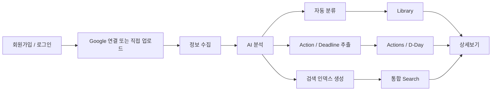
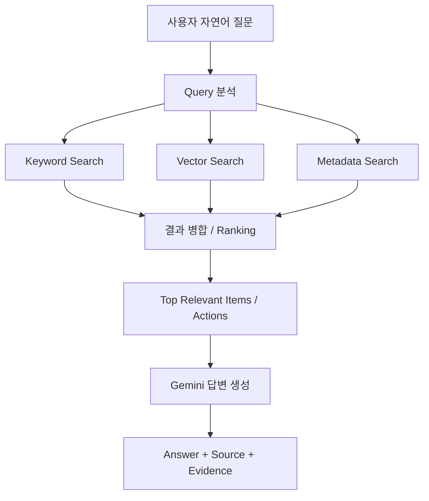
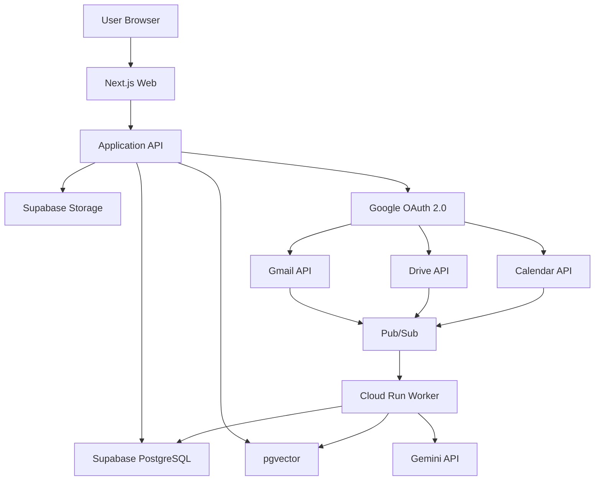
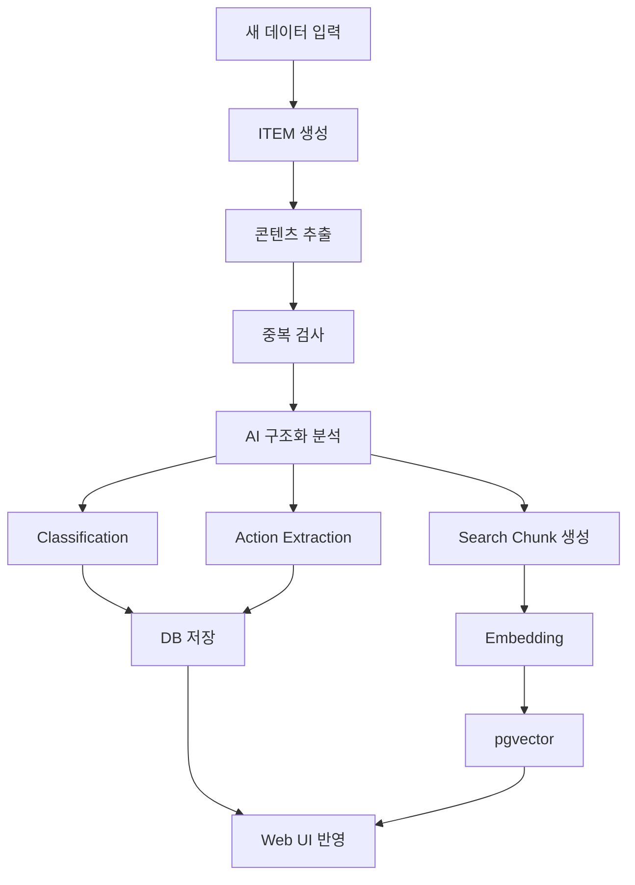

# AI 통합 정보 허브 — 개발 명세서

> 문서명: `SPEC.md`  
> 기준본: Notion 「AI 통합 정보 허브 — 서비스 기획 및 개발 기준서 v0.5」  
> 문서 목적: Codex 및 개발자가 실제 구현 시 참고하는 저장소 내 상세 명세  
> 상태: v0.1

---

## 1. 문서 목적

이 문서는 AI 통합 정보 허브의 실제 개발 기준을 저장소 안에서 확인할 수 있도록 정리한 개발 명세다.

제품의 최상위 기준은 Notion의 「AI 통합 정보 허브 — 서비스 기획 및 개발 기준서 v0.5」이며, 이 문서는 해당 기준을 개발용으로 구조화한 문서다.

### 우선순위

1. Notion 「AI 통합 정보 허브 — 서비스 기획 및 개발 기준서 v0.5」
2. `SPEC.md`
3. `README.md`
4. 실제 구현 코드

코드 구현이 문서와 다르다는 이유로 문서를 임의 수정하지 않는다.

기준 변경이 필요한 경우 기존 기준과 변경안을 비교한 뒤 명시적으로 승인된 내용만 반영한다.

---

# 2. 서비스 정의

AI 통합 정보 허브는 Gmail, Google Drive, Google Calendar와 사용자가 직접 올린 PDF, 이미지, 스크린샷, 문서, 텍스트 등의 정보를 한곳에 모아 AI가 자동 분류하고 통합 검색하며, 문서 속 해야 할 일과 마감일을 찾아 D-Day로 관리해주는 개인 AI 정보 허브다.

---

# 3. 해결하려는 문제

1. 메일, 파일, 일정, 캡처가 서로 다른 서비스에 흩어져 있다.
2. 파일명이나 메일 제목을 정확히 기억하지 못하면 다시 찾기 어렵다.
3. 공고문이나 메일을 읽어도 신청, 제출, 납부, 갱신 같은 실제 행동을 놓칠 수 있다.
4. 사용자가 직접 파일을 분류하고 마감일을 정리해야 한다.

---

# 4. 핵심 가치

## 4.1 COLLECT

정보를 모은다.

### 자동수집

- Gmail
- Google Drive
- Google Calendar

### 직접입력

- PDF
- 이미지
- 스크린샷
- 일반 문서
- 텍스트
- 클립보드 붙여넣기

---

## 4.2 FIND

AI가 분류하고 찾아준다.

- AI 자동분류
- Keyword Search
- Vector Search
- Metadata Search
- 자연어 통합검색
- Answer + Source + Evidence
- 관련 정보가 없으면 추측하지 않음

---

## 4.3 ACT

해야 할 일을 놓치지 않게 한다.

- Action 추출
- Deadline 추출
- Requirements 추출
- Conditions 추출
- D-Day 관리
- Source / Evidence 연결
- 동일 Action 중복 병합
- 마감일 변경 처리

---

# 5. v1 Scope

## 5.1 포함 범위

- Gmail 자동수집
- Google Drive 자동수집
- Google Calendar 자동수집
- PDF 직접 업로드
- 이미지 직접 업로드
- 스크린샷 직접 업로드
- 일반 문서 입력
- 텍스트 입력
- 클립보드 붙여넣기
- AI 자동분류
- 자연어 통합검색
- Action 추출
- Deadline 추출
- D-Day 관리
- Source 표시
- Evidence 표시
- 사용자 AI 분류 수정
- Google 연결 해제 및 재연결
- 데이터 삭제 관리

---

## 5.2 v1 제외 범위

다음 기능은 v1에서 개발하지 않는다.

- SMS 자동수집
- 카카오톡 자동수집
- 네이버메일 자동연동
- Outlook 자동연동
- 파일의 실제 폴더 자동이동
- 자동 신청
- 자동 제출
- 자동 결제
- 복잡한 Life Graph 시각화
- 네이티브 모바일 앱

---

# 6. 사용자 흐름



---

# 7. Unified ITEM

## 7.1 핵심 원칙

입력 경로가 달라도 시스템 내부에서는 모두 하나의 정보 단위인 **Unified ITEM**으로 처리한다.

```text
Gmail ───────────┐
Google Drive ────┤
Google Calendar ─┤
PDF ─────────────┤
Image ───────────┤──> Unified ITEM
Screenshot ──────┤
Document ────────┤
Text ────────────┘
```

Gmail, Drive, Calendar별 독립 데이터 모델을 중심 구조로 만들지 않는다.

---

## 7.2 ITEM 기본 필드

현재 기준 필드:

```text
id
user_id
source
format
external_id
title
original_url
storage_path
content_text
content_hash
processing_status
created_at
updated_at
```

DB Migration 단계에서 타입, 제약조건, FK, 인덱스, nullable 여부를 확정한다.

---

# 8. AI Classification

## 8.1 분류 구조

| 분류 | 의미 | 예시 |
|---|---|---|
| Source | 유입 경로 | Gmail |
| Format | 데이터 형태 | PDF |
| Topic | 핵심 주제 | 장학금 |
| Document Type | 자료 성격 | 공지·안내 |
| Tags | 세부 키워드 | 학교, 재학생, 등록금 |

---

## 8.2 Topic 규칙

1. Primary Topic은 기본적으로 1개를 둔다.
2. 기존 Topic과 유사하면 기존 Topic을 재사용한다.
3. 유사 Topic이 무한정 늘어나지 않도록 한다.
4. 사용자가 수정할 수 있다.
5. 사용자가 수정한 값은 AI 재분석보다 우선한다.

---

## 8.3 Document Type v1

- 공지·안내
- 신청·접수
- 계약·약관
- 결제·청구
- 예약·확인
- 증명·제출서류
- 일정·초대
- 일반자료
- 기타

---

# 9. Action / D-Day

## 9.1 Action 생성 기준

**날짜가 있다는 이유만으로 Action을 생성하지 않는다.**

사용자가 실제로 해야 하거나 선택해야 하는 행동이 있을 때만 Action을 생성한다.

---

## 9.2 Action Type

| Type | 의미 | 예시 |
|---|---|---|
| `required` | 반드시 해야 하는 일 | 서류 제출, 납부 |
| `optional` | 신청·선택 | 장학금 신청 |
| `check` | 조건 확인 필요 | 대상자 여부 확인 |

---

## 9.3 D-Day 생성 기준

1. 명확한 마감일이 있는 경우에만 생성한다.
2. 날짜를 추측하지 않는다.
3. 불명확하면 `마감일 확인 필요`로 표시한다.
4. 행사 날짜와 신청 마감일을 분리한다.
5. 신청 시작일과 마감일을 분리한다.

표시 예:

```text
D-7
D-1
D-DAY
기한 초과 +2일
마감일 확인 필요
```

---

## 9.4 중복 Action

동일 안내가 Gmail, Drive, Upload 등 여러 Source에서 반복 발견되더라도 Action은 1개만 유지한다.

```text
Action 1개
   ├─ Gmail Source
   ├─ Drive Source
   └─ Upload Source
```

즉:

```text
1 Action : N Sources
```

구조를 사용한다.

---

## 9.5 마감일 변경

마감일이 연장되면:

- 기존 Action 유지
- Deadline 갱신
- 새 Source 연결
- 변경 이력 추가

새 Action을 무조건 생성하지 않는다.

---

## 9.6 날짜 충돌

출처 간 날짜가 충돌할 경우:

- 최신 공지임이 명확하면 최신 기준 적용 가능
- 최신성이 명확하지 않으면 AI가 임의 선택하지 않음
- `마감일 확인 필요` 상태로 처리

---

# 10. Search

## 10.1 검색 대상

- Gmail 제목
- Gmail 본문
- Gmail 발신자
- Drive 파일명
- Drive 파일 내용
- 업로드 파일 내용
- 이미지 분석 내용
- 캡처 분석 내용
- Calendar 제목
- Calendar 설명
- Calendar 날짜
- Action 제목
- Action 마감일
- Action Requirements

---

## 10.2 검색 방식

검색은 다음을 결합한다.

```text
Keyword Search
+
Vector Search
+
Metadata Search
```

검색 흐름:



---

## 10.3 검색 결과 원칙

검색 결과는 다음 요소를 고려한다.

1. 질문과의 관련도
2. 날짜 조건 일치도
3. Source 조건 일치도
4. Format 조건 일치도
5. Action / Deadline 중요도
6. 최신성

세부 Ranking 가중치는 아직 미확정이다.

---

## 10.4 AI 검색 답변 원칙

AI가 답변을 생성하면 가능한 경우 반드시 아래 구조를 사용한다.

```text
Answer
Source
Evidence
```

근거가 없는 경우 답변을 추측하지 않는다.

---

# 11. 데이터 처리 정책

## 11.1 직접 업로드

직접 업로드한 파일은 Supabase Storage에 원본을 저장한다.

별도로 다음 데이터를 관리한다.

- 추출 콘텐츠
- AI Metadata
- Search Index
- Embedding
- Action
- Evidence

---

## 11.2 Google 데이터

Google 원본은 Google에 유지한다.

서비스에는 검색, 분류, Action 생성에 필요한 데이터만 저장한다.

Google 원본 데이터:

- Gmail
- Google Drive
- Google Calendar

서비스에서 분석 데이터를 삭제하더라도 Google 원본은 삭제하지 않는다.

---

## 11.3 Google 연결 해제

연결 해제 시:

- 신규 동기화 중단
- 기존 분석 데이터 유지
- 기존 검색 유지
- 기존 Action 유지
- 기존 D-Day 유지
- 재연결 시 동기화 재개

---

## 11.4 데이터 삭제

Settings > Data Management에서 다음 기능을 제공한다.

- 업로드 파일 전체 삭제
- Google 분석 데이터 삭제
- 모든 서비스 데이터 삭제

Google 원본은 삭제하지 않는다.

---

# 12. 시스템 아키텍처



---

# 13. 기술 스택

| 영역 | 기술 |
|---|---|
| Frontend | Next.js + TypeScript |
| UI | Tailwind CSS + shadcn/ui |
| Database | Supabase PostgreSQL |
| Storage | Supabase Storage |
| Vector Search | pgvector |
| Authentication | Supabase Auth |
| Google Auth | Google OAuth 2.0 |
| Google Integration | Gmail / Drive / Calendar API |
| AI | Gemini API |
| Embedding | Gemini Embedding |
| Worker | Google Cloud Run |
| Event | Google Cloud Pub/Sub / Webhook |
| Deploy | Vercel |

기술스택은 명시적 변경 승인 없이 교체하지 않는다.

---

# 14. AI 처리 파이프라인



---

## 14.1 Processing Status

```text
uploaded
↓
queued
↓
extracting
↓
analyzing
↓
indexing
↓
completed
```

실패 시:

```text
failed → retry
```

---

## 14.2 AI 결과 검증

1. 날짜 근거 없음 → D-Day 확정 금지
2. 행동 요구 없음 → Action 생성 금지
3. 대상 불명확 → `check`
4. 기존 Action과 유사 → 병합 검토
5. 기존 Topic과 유사 → 기존 Topic 사용
6. 사용자 수정값 → AI 결과보다 우선

---

# 15. 핵심 데이터베이스 구조

현재 기준 핵심 테이블:

| 테이블 | 역할 |
|---|---|
| `users` | 사용자 |
| `connections` | Google 등 외부서비스 연결 |
| `items` | 모든 정보의 기본 단위 |
| `classifications` | Topic / Document Type / Tags |
| `actions` | 해야 할 일 / D-Day |
| `action_sources` | Action과 원문 Source/Evidence 연결 |
| `search_chunks` | 검색용 Chunk + Embedding |

실제 Column, Enum, FK, RLS, Index, pgvector 설정은 DB Migration 단계에서 확정한다.

---

# 16. 화면 구조

## 16.1 공통 Web Shell

Desktop 기본 구조:

```text
┌─────────────────────────────────────────────────────────────┐
│ AI HUB       [ Global Search ..................... ]  + Add │
├──────────────┬──────────────────────────────────────────────┤
│ Home         │                                              │
│ Library      │                                              │
│ Search       │                 Main Content                 │
│ Actions      │                                              │
│              │                                              │
│ Settings     │                                              │
└──────────────┴──────────────────────────────────────────────┘
```

### Global Search

전체 서비스에서 사용할 수 있는 통합 검색창을 상단에 둔다.

### + Add

직접입력 전용이다.

- PDF / 문서 업로드
- 이미지 / 스크린샷 업로드
- Drag & Drop
- 텍스트 / Clipboard 붙여넣기

Gmail, Drive, Calendar 데이터는 `+ Add`가 아니라 연결 및 동기화를 통해 수집한다.

---

# 17. HOME

목적:

**오늘 사용자가 확인하거나 처리해야 하는 정보를 먼저 보여주는 화면**

우선순위:

```text
통합검색
↓
가까운 D-Day
↓
확인 필요
↓
최근 ITEM
```

포함 요소:

- 통합 검색창
- MY ACTIONS
- 가까운 D-Day
- 확인 필요 Action
- 최근 추가 정보

단순 통계 Dashboard보다 실제 행동 우선 구조를 사용한다.

---

# 18. LIBRARY

목적:

Unified ITEM 전체 조회 및 분류 상태 확인.

필터:

- Source
- Format
- Topic
- Document Type
- 날짜

Gmail, Drive, Calendar, Upload 데이터를 별도 메뉴로 분리하지 않는다.

Source 차이는 Badge 등 UI 표현으로 구분한다.

예:

```text
[Gmail]
[Drive]
[Calendar]
[Upload]
```

---

# 19. SEARCH

Search는 챗봇 중심 UI로 만들지 않는다.

기본 구조:

```text
사용자 질문
↓
AI Answer
↓
Source
↓
Evidence
↓
관련 ITEM / Action
```

검색 결과에는:

- 관련 ITEM
- 관련 Action
- Source
- Evidence
- 관련도 정보

를 표시할 수 있다.

AI가 확정할 수 없는 내용은 확정형 문장으로 생성하지 않는다.

---

# 20. ACTIONS

기본 필터:

- 전체
- 해야 할 일
- 신청·선택
- 확인 필요
- 완료

UI 표시명:

```text
required → 해야 할 일
optional → 신청·선택
check → 확인 필요
```

Action 카드에는 다음 정보를 표시할 수 있다.

- Action 제목
- Action Type
- Deadline
- D-Day
- Source 수
- 상태

---

# 21. DETAIL

Desktop은 2단 구조를 기본으로 한다.

```text
Original Preview | AI Analysis
```

AI Analysis에는 다음을 표시한다.

- Topic
- Document Type
- Tags
- Action
- Deadline
- Requirements
- Conditions
- Evidence

사용자는 AI 분류값을 수정할 수 있다.

사용자가 수정한 값은 `User Edited` 상태로 관리하고 자동 재분석으로 덮어쓰지 않는다.

---

# 22. SETTINGS / CONNECTIONS

포함 기능:

- Google 연결 상태
- Google 재연결
- Google 연결 해제
- 데이터 관리
- 업로드 파일 전체 삭제
- Google 분석 데이터 삭제
- 모든 서비스 데이터 삭제

Google 연결을 해제하더라도 기존 분석 데이터와 Action은 유지한다.

---

# 23. Responsive UI

v1은 네이티브 모바일 앱이 아니라 반응형 Web이다.

Desktop:

```text
Sidebar + Main
```

Mobile:

```text
Main
↓
Bottom Navigation
```

Detail 모바일 순서:

```text
Original Preview
↓
AI Metadata
↓
Action
↓
Evidence
```

---

# 24. URL Structure

예정 Route:

```text
/
├─ /login
├─ /library
├─ /search
│  └─ ?q=
├─ /actions
├─ /items/[itemId]
└─ /settings
   ├─ /connections
   └─ /data
```

실제 Next.js 구현 시 Route 구조가 변경될 필요가 있다면 기존 기준과 차이를 먼저 명시한다.

---

# 25. 개발 단계

## Phase 0 — 프로젝트 기본 세팅

- [ ] Git Repository
- [ ] Next.js + TypeScript
- [ ] Tailwind CSS + shadcn/ui
- [ ] Supabase 프로젝트
- [ ] Google Cloud 프로젝트
- [ ] Dev / Production 환경 분리

---

## Phase 1 — 로그인 + Web Shell

- [ ] 회원가입 / 로그인
- [ ] Sidebar
- [ ] Home
- [ ] Library
- [ ] Search
- [ ] Actions
- [ ] Settings
- [ ] + Add

---

## Phase 2 — 직접 업로드

- [ ] PDF Upload
- [ ] 이미지 Upload
- [ ] Screenshot Upload
- [ ] Drag & Drop
- [ ] Clipboard Paste
- [ ] Supabase Storage 저장
- [ ] ITEM 생성

---

## Phase 3 — AI 분석

- [ ] 콘텐츠 추출
- [ ] 이미지/PDF 이해
- [ ] Structured Output
- [ ] Topic
- [ ] Document Type
- [ ] Tags
- [ ] Search Chunk
- [ ] Embedding

---

## Phase 4 — Library / Detail

- [ ] ITEM 리스트
- [ ] Filter
- [ ] 원본 미리보기
- [ ] AI Metadata
- [ ] 사용자 수정

---

## Phase 5 — Action / D-Day

- [ ] Action 추출
- [ ] Deadline 추출
- [ ] Requirements 추출
- [ ] Conditions 추출
- [ ] Evidence 저장
- [ ] D-Day 계산
- [ ] 중복 Action 처리
- [ ] 수정 공지 처리

---

## Phase 6 — 통합 검색

- [ ] Full Text Search
- [ ] pgvector
- [ ] Metadata Filter
- [ ] Hybrid Ranking
- [ ] Answer + Source + Evidence

---

## Phase 7 — Google 연결

- [ ] Google OAuth
- [ ] Gmail 초기 동기화
- [ ] Drive 초기 동기화
- [ ] Calendar 초기 동기화
- [ ] Unified ITEM 변환

---

## Phase 8 — 자동 동기화

- [ ] Gmail 변경 감지
- [ ] Drive 변경 감지
- [ ] Calendar 변경 감지
- [ ] Background Worker
- [ ] 재분석
- [ ] Action 갱신
- [ ] 검색 인덱스 갱신

---

## Phase 9 — Settings / Data Management

- [ ] 연결 해제
- [ ] 재연결
- [ ] 업로드 데이터 삭제
- [ ] Google 분석 데이터 삭제
- [ ] 전체 서비스 데이터 삭제

---

## Phase 10 — 통합 QA / Demo

- [ ] PDF 테스트
- [ ] Screenshot 테스트
- [ ] Gmail 테스트
- [ ] 중복 Action 테스트
- [ ] 마감일 변경 테스트
- [ ] 검색 테스트

---

# 26. 구현 순서

상세 설계는 다음 순서를 따른다.

```text
Wireframe
↓
DB Migration
↓
API Specification
↓
AI Structured Output
↓
Implementation
```

앞 단계가 확정되기 전에 뒷 단계의 구조를 임의 확정하지 않는다.

---

# 27. v1 완료 기준

- [ ] 파일을 올리면 자동 분석된다.
- [ ] Gmail / Drive / Calendar가 동일한 ITEM 구조로 들어온다.
- [ ] AI 분류 결과를 웹에서 확인할 수 있다.
- [ ] 사용자가 잘못된 분류를 수정할 수 있다.
- [ ] 사용자 수정값은 AI 재분석으로 덮어쓰지 않는다.
- [ ] 메일 / 문서에서 실제 Action을 추출한다.
- [ ] 명확한 마감일을 D-Day로 표시한다.
- [ ] Action마다 Source / Evidence가 있다.
- [ ] 자연어로 메일, 파일, 일정, Action을 함께 검색할 수 있다.
- [ ] Google 연결 해제 후 기존 데이터가 유지된다.
- [ ] Settings에서 데이터를 삭제할 수 있다.

---

# 28. 개발 원칙

1. AI 챗봇처럼 만들지 않는다.
2. 파일을 실제로 이동시키지 않는다.
3. Deadline, 제출 의무, 적용조건은 Evidence를 가져야 한다.
4. User Edited 값은 자동 재분석으로 덮어쓰지 않는다.
5. 모든 ITEM과 Action은 원본 Source를 추적할 수 있어야 한다.
6. 모든 입력 데이터는 Unified ITEM 구조를 따른다.
7. v1 Scope는 COLLECT · FIND · ACT에 직접 기여하는 기능만 개발한다.
8. Google 원본 데이터는 서비스에서 임의로 삭제하지 않는다.
9. AI는 날짜와 조건을 근거 없이 추측하지 않는다.

---

# 29. 현재 확정된 Wireframe 기준

현재 Wireframe v0.1 기준:

- 공통 Sidebar
- 상단 Global Search
- `+ Add`
- HOME: Action 우선
- LIBRARY: Unified ITEM 중심
- SEARCH: Answer + Source + Evidence
- ACTIONS: required / optional / check
- DETAIL: Desktop 좌우 2단
- SETTINGS: Connections + Data Management
- Mobile: Bottom Navigation
- Processing Status UI 제공

이 항목들은 기능 추가가 아니라 Notion v0.5 요구사항을 실제 화면으로 구체화한 내용이다.

---

# 30. 아직 최종 결정이 필요한 항목

다음 항목은 아직 최종 확정 전이다.

- 최종 서비스명
- DB Migration 최종 Schema
- Enum 세부 구조
- RLS 정책
- Index 구성
- pgvector 세부 설정
- Google OAuth Scope
- API Specification
- AI Structured Output Schema
- Action Validation Rule 세부안
- Search Ranking 세부 알고리즘
- 테스트 Google 계정
- 테스트 PDF / 캡처 데이터셋
- 역할 분담
- Git Branch 전략

Codex는 위 항목을 임의로 확정된 요구사항처럼 처리하지 않는다.

---

# 31. 변경 관리

새로운 기능이나 설계 변경이 발생하면 다음 순서로 처리한다.

1. Notion v0.5와 충돌 여부 확인
2. 기존 기준 확인
3. 변경 필요성 설명
4. 변경 전 / 변경 후 비교
5. 승인 후 SPEC 반영
6. 구현
7. README 또는 관련 문서 갱신이 필요한지 확인

---

# 32. 현재 개발 진행 상태

```text
[완료] 서비스 기획 및 개발 기준서 v0.5
[완료] 화면 Wireframe v0.1
[다음] DB Migration v0.1
[대기] API Specification
[대기] AI Structured Output
[대기] Implementation
```

다음 설계 작업은 **Supabase PostgreSQL DB Migration v0.1**이다.

## 33. 승인된 Implementation Phase 6A 범위 (2026-10-04)

위 32절은 초기 기획 당시의 단계 기록이다. Phase 1–5 완료 후 저장된 Gmail ITEM만 Gemini로 분석하는
Phase 6A를 구현한다. 출력 기준은 루트 AI_OUTPUT_SPEC.md / AI_OUTPUT_SCHEMA.json v0.2이며,
eventObservations를 Action과 독립적으로 items.metadata.aiAnalysis에 저장하고 schemaVersion="0.2"를 보존한다.
description은 추가하지 않는다. 기존 테이블 구조·Gmail 수집·Notion 원본은 변경하지 않는다.
승인된 persist_gmail_item_analysis 서버 전용 RPC로 Classification + Action + Evidence를 단일 transaction에
저장한다. 사용자 override와 기존 Action 완료 상태를 유지한다. 실패는 전체 rollback하며,
같은 본문·모델·버전은 재사용한다. 모호한 Action 재매칭은 자동 증식/삭제 대신 저장 오류로 처리한다.
분석 성공은 indexing 대기이며 Search/Embedding 완료가 아니다. 실제 Gmail 검증은 최대 5개 ITEM이다.
AI 생성에 전달하는 구조 스키마는 provider 지원 subset이며, 저장 전 전체 v0.2 schema·Evidence·날짜 검증은 필수다.
검색/UI 고도화/Drive/Calendar/Upload/Phase 6B는 이 범위에 포함하지 않는다.

## 34. 승인된 Implementation Phase 6B 완료 (2026-10-04)

**Phase 6B COMPLETE.** Phase 6A 저장 결과를 기존 ITEM Detail 조회 API와 TypeScript 데이터 계약에
연결했다. 6B-1은 조회 계약·타입 확정, 6B-2는 실제 조회 연결, 6B-3는 통합 검증 및 인계다.
기존 응답을 유지하며 AI/User/Effective 분류, DB Action의 requirements/conditions/시작일/마감일/
완료 상태, Source Evidence 및 독립된 eventObservations, 안전한 AIAnalysis 요약을 조회한다.
사용자 override 우선과 명시적 빈 tags를 보존한다. indexing은 검색/Embedding 대기 상태다.
상세 필드 의미와 검증 범위는 API_SPEC.md 23절, 현재 인계 상태는 docs/PROJECT_STATE.md를 따른다.

실제 개발 DB RLS principal의 읽기 전용 조회와 production 조회/GET handler adapter 검증 PASS.
미인증 production HTTP 차단 PASS. 실제 Browser OAuth/인증 cookie E2E는 재실행하지 않았고,
로그인·세션·Logout/Re-login은 기존 mock 회귀로 검증했다. 실제 override/행사 관찰값 샘플은 없으며
합성 검증 PASS와 구분한다. 실제 event-date Gmail 회귀 TODO는 Phase 6A 기록대로 유지한다.
52개 격리 테스트, typecheck/lint/build/Supabase 연결 검사/diff 검사 PASS.

이 Phase는 새로운 UI/UX, API 업무 기능, DB Schema/Migration/RLS 변경 또는 Gemini 재분석을
포함하지 않는다. AI 출력 Schema/Prompt와 기존 분석 저장 구조를 변경하지 않았다.
다음 단계의 명칭·목표·범위는 사용자 지시로 별도 확정하며, 이 완료 기록은 후속 구현 승인이 아니다.

## 35. 승인된 Drive MVP 및 Drive-3 범위 (2026-10-05)

Drive-1 COMPLETE, Drive-2 수정 승인. Google Docs만, 사용자가 지정한 폴더 바로 아래 문서 또는 명시한 fileId 집합만 수집한다.
폴더 재귀 탐색/전체 Drive/공유 드라이브는 제외하며, 공유받은 개별 Docs는 명시 지정·읽기 권한이 있으면 허용한다.
원본은 Google에 유지하며 Storage 복사본 없이 Unified ITEM의 텍스트·참조정보만 저장한다.
source=drive, format=document, external_id=fileId, external_container_id=NULL, original_url 사용,
storage_path=NULL, 신규 processing_status=queued. Google 생성/수정시각과 서비스 저장시각을 구분한다.

수집 상한: 실행당 20건, 문서당 Unicode code point 100,000 AND UTF-8 400,000 bytes,
실행 전체 새로 읽는 추출 텍스트 2,000,000 bytes, 병렬 2건, Google 요청 10초/파일 30초/실행 목표 120초,
pageSize 20/최대 5페이지, 429/5xx만 추가 1회 retry. 실제 Vercel 설정과 실행 목표는 배포 전 확인한다.
초과 문서는 truncate하지 않고 신규 ITEM 미생성/기존 정상 본문 유지 및 결과 구분.

추출 계약: 모든 tab, 부모→child 순서, 본문/표/목차와 문서 순서 유지,
includeTabsContent=true, PREVIEW_WITHOUT_SUGGESTIONS. header/footer/footnote/comment/image 내용/OCR/
미수락 suggestion 제외. 제외 구조 여부를 metadata에 기록하고 전체 내용 지원으로 표시하지 않는다.
tab 제목은 본문에 생성 삽입하지 않고 metadata에 Unicode code point 범위와 함께 기록한다.
Google 원본 index는 Evidence offset으로 사용하지 않는다. 추출 버전은 docs-text-v1이다.

동일 fileId는 같은 ITEM. modifiedTime 동일은 본문 다운로드 생략(정상 추출 기록/추출 버전 확인),
변경은 같은 ITEM 갱신. 읽기 전후 modifiedTime 변경은 SOURCE_CHANGED로 이전 본문 유지.
폴더 이동은 identity 유지. Classification/user override/Action/Evidence는 수집에서 변경하지 않는다.
Google 삭제/접근 상실은 ITEM·본문 보존하며 목록 부재만으로 삭제 판정하지 않는다.
사용자 직접 삭제/보존기간/Drive 분석/재분석/Search/Embedding은 후속 범위.
Cross-ITEM Action 병합은 Drive AI 분석 전에 별도 결정한다.

Drive 단계 체계는 Drive-1/Drive-2/Drive-3 총 3단계다. Drive-1/2/3 및 전체 Drive COMPLETE. 실제 검증 범위와 한계는 docs/PROJECT_STATE.md를 따른다.
Drive-3 승인 범위는 OAuth/Token 경계, Drive client, Docs 추출, ITEM 저장·재수집, collect API와 실제 E2E/회귀 검증 전체다.
서비스 로그인 OAuth는 변경하지 않는다. persist_drive_item은 정적 검증용 SQL 초안만 작성하고 별도 승인 전 적용하지 않는다.
ITEM table/column/index/RLS 변경 금지. persist_drive_item 함수 적용은 별도 승인 후 개발 DB에서만 진행한다.
Drive-3 완료 후 멈추고 Calendar는 시작하지 않는다.
Restricted Scope 상용화 검증 및 하위 폴더 탐색은 TODO. drive.file+Google Picker는 이번 MVP에서 구현하지 않는다.

## 36. 승인된 Calendar MVP / Calendar-2 (2026-10-05)

사용자 승인: Calendar-1 COMPLETE. Calendar-2는 OAuth/Scope, client, Event validation/ITEM 변환,
collect API, Detail 원본 데이터 조회, 함수 Migration 초안, 외부 호출 없는 격리 검증을 구현한다.
Calendar-3에서 별도 승인 후 실제 Scope 동의·개발 DB Migration 적용·Event 1~3건 E2E와 최종 회귀를 수행한다.
Calendar 단계는 1/2/3만 사용한다. UI/UX, 자동 동기화, AI/Search/Embedding은 이번 구현 범위가 아니다.

동일 Google Data 계정의 primary 한 개만, eventType=default 일반/초대 일정과 기간 내 recurring occurrence를 수집한다.
공유/선택/생일/공휴일 별도 calendar 및 모든 비-default 유형은 제외한다. 일반 일정 제목을 보고 생일/공휴일을 추측하여 제외하지 않는다.
실행 시작시각을 고정한 과거 30일~미래 90일, singleEvents=true/showDeleted=true/eventTypes=default를 사용한다.
Google timeMin은 종료시각 하한, timeMax는 시작시각 상한이므로 기간과 겹치는 일정을 포함한다.
pageSize 50/최대 4페이지/최대 200개(취소 포함), 빈 페이지의 nextPageToken도 처리한다.
Google 요청 10초/실행 목표 120초/추가 fresh GET 최대 20건. Event당 100,000 code points AND 400,000 UTF-8 bytes,
실행 canonical text 2,000,000 bytes 상한. 초과 시 truncate 없이 부분 결과를 구분한다. 배포 maxDuration 150 지원 여부는 실제 배포에서 확인한다.
429/5xx/403 rateLimitExceeded만 추가 1회 retry, Retry-After 존중 및 대기 최대 1초. 일반 403/404/timeout/불명확 네트워크 오류는 retry하지 않는다.

최소 Scope는 calendar.events.owned.readonly이며 Gmail/Drive metadata/Docs와 기존 identity Scope를 보존한다.
calendar_scope_upgrade는 기존 연결/동일 Google sub/실제 granted scopes 및 refresh 가능성을 입증한 뒤 bundle을 교체한다.
부분 승인/다른 계정/Scope 축소/stale callback/실패는 저장 차단. 일반 재연결과 기존 Drive upgrade에서도 Calendar 권한을 보존한다.
서버 및 DB allowlist는 같은 9개 허용 문자열(identity alias 포함)이며 서비스 로그인은 변경하지 않는다.
Calendar 추가 동의는 새 전용 upgrade_google_calendar_scopes RPC로 전체 sync_state와 Gmail/Drive checkpoint,
last_synced_at/connected_at를 보존한다. 기존 guarded refresh와 disconnect 경계를 유지한다.
OAuth Scope 등록/동의와 AI Hub Dev의 Google Calendar API 활성화는 별개이며 이번에는 실제 설정을 변경하지 않는다.

Unified ITEM: source=calendar, format=calendar_event, external_container_id=primary(API alias), external_id=Google instance eventId.
primary alias는 connection/Google 계정에 묶인 namespace이며 실제 calendar 고유 ID라고 표시하지 않는다.
향후 선택 calendar 도입 시 alias/실제 ID의 중복 방지 계약을 먼저 결정한다. 현재 start는 identity로 사용하지 않는다.
recurring master는 미저장, recurringEventId/originalStartTime은 관계 추적 metadata로 보존한다.
title=summary 또는 빈 문자열. content_text는 제목→HTML에서 변환한 일반 텍스트 설명→장소→시작/배타적 종료→calendar timezone의 고정 canonical text.
hash는 해당 UTF-8 text SHA-256, extractionVersion=calendar-text-v1. source_created_at/source_updated_at는 Google 값 또는 null,
mime_type/storage_path=null, 신규 processing_status=queued. queued는 AI 호출이나 색인 완료를 뜻하지 않는다.
Google Calendar HTTPS htmlLink만 검증하여 original_url로 사용하며 없거나 안전하지 않으면 null이다.
metadata.calendar는 Event/date/status/etag/version/반복 참조만 whitelist로 저장한다. organizer/creator/attendees/conferenceData/
attachments/reminders/extendedProperties를 요청/저장하지 않는다. 설명 자체에 포함된 개인정보 제거를 보장하는 정책은 아니다.

Calendar start/end/all-day는 event date이며 Action deadline과 독립적이다. all-day는 YYYY-MM-DD를 그대로 보존하고 UTC 자정을 만들지 않는다.
timed dateTime은 명시적 offset을 가진 RFC3339로 검증하며 IANA timezone을 보존한다. 불명확한 구조는 실패로 처리한다.
수집은 Classification/Action/Deadline/AI eventObservations를 생성하지 않으며 Gemini를 호출하지 않는다.

persist_calendar_item은 service_role 전용/SECURITY DEFINER/빈 search_path이며 connection→ITEM lock 순서,
owner/active Google connection/Scope/Token/identity/hash/날짜/whitelist 검증, 원자 create/reuse/update, ITEM snapshot CAS를 수행한다.
Google HTTP 동안 DB transaction/lock을 잡지 않는다. 동일 metadata/version/hash는 UPDATE 없이 reuse한다.
ETag는 순서 증명이 아니므로 기존 ITEM 변경에는 더 최신인 updated가 필요하다. missing/equal/older source version의 변경은 SOURCE_CHANGED 실패로 기존 값을 보존한다.
신규 정상 Event는 source created/updated가 없어도 null로 저장할 수 있지만 이후 순서를 입증하지 못하는 변경은 거부한다.
기존 취소 또는 취소 상태의 복원은 이전 ITEM snapshot을 잡은 뒤 fresh GET으로 확인한다.
명시적 취소는 최신 updated를 확인할 수 있을 때 status/etag/updated만 갱신하고 마지막 정상 본문/날짜/URL/분석을 보존한다.
취소 updated가 없거나 순서가 불명확하면 저장 거부. 처음 보는 취소는 skipped이며 ITEM을 만들지 않는다.
목록 부재/기간 밖 이동/접근 상실만으로 삭제·취소를 확정하지 않는다. 기간 조회 MVP는 모든 삭제·기간 밖 변경 탐지를 보장하지 않는다.
Classification/user override/Action/Evidence/metadata.aiAnalysis 및 기존 processing_status는 갱신에서 보존한다.

현재 table/column/index/RLS는 변경하지 않는다. 새 함수 Migration 두 개는 Calendar-3 사용자 승인으로 ai-hub-dev에만 적용했다.
Production 미적용이며 다른 환경 적용은 별도 승인 범위다. 기존 Migration 이력 repair/reset은 하지 않았다.
API/Detail 계약은 API_SPEC.md 25절, 완료 검증 범위·실행 한계는 docs/PROJECT_STATE.md를 따른다.


# 28. 승인된 PDF/이미지 직접 업로드 MVP (Upload-1/2/3, 2026-10-05)

사용자 승인에 따라 PDF, PNG, JPG/JPEG만 Unified ITEM source=upload/format=pdf|image로 처리한다.
서버 UUID는 ITEM identity, 사용자별 원본 bytes SHA256은 dedupe identity, text hash는 content_hash다.
같은 bytes는 filename에 관계없이 본인 ITEM 재사용, 다른 사용자에게 중복 여부 노출 없음.
Google 원본/연결 모델 및 AI Structured Output은 변경하지 않는다.

Storage 원본은 비공개 upload-originals, 경로 userId/uploadUuid/original.validatedExtension, overwrite 금지.
원본 filename은 정규화한 표시값이며 경로에 쓰지 않는다. 본인 검증된 ITEM만 60초 원본 signed URL.
세션/Storage 검증 후 pending ITEM, text PDF는 서버 PDF.js embedded 추출,
PNG/JPEG는 브라우저 Tesseract.js, scan page는 브라우저 PDF.js render + Tesseract.js로 처리한다.
서버가 원본과 page plan을 재검증하고 전체 결과의 normalize/hash/code point range를 계산해 원자 저장한다.
브라우저 OCR은 untrusted client input이며 원본과의 의미 일치를 서버가 보증하지 않는다.
prepare 후 lease를 해제하고 complete에 새 attempt/CAS를 사용한다. 탭 종료는 즉시 failed로 판단하지 않는다.
완료된 동일 bytes ITEM을 우선 reuse하며 미완료 중복은 UPLOAD_IN_PROGRESS로 기존 session 재시도를 안내한다.
원본 파일은 변경하지 않는다. 동일 complete 재시도/attempt lease CAS/안전 orphan 정리를 구현한다.
기존 enum uploaded→queued→extracting→queued로 충분하며 마지막 queued는 후속 AI 대기다.
metadata.upload.extraction.status 및 safe Detail page map으로 추출 완료와 AI 완료를 구분한다.

상한·HTTP·상태·Evidence 세부 계약은 API_SPEC.md 24절, parser 격리/보수적 PDF 제한 및
배포 조건은 workers/upload/README.md에서 관리한다. OCR confidence는 참고값이며 문자 삭제에 쓰지 않는다.
Library에 기능용 upload/progress/cancel/retry 제어만 연결하며 화면 스타일/배치 디자인과 provider별 화면은 만들지 않는다.
Classification/Action/Deadline/Embedding 및 Gemini 분석은 이 단계에 포함하지 않는다.

Upload 단계는 1/2/3만 사용한다. Upload-2는 Migration/Storage policy 초안 및 격리 테스트까지.
기존 Upload Migration/bucket/policy는 dev에 적용되어 있다. Cloud Vision/Cloud Run/Billing/OCR ADC는 MVP 제외,
기존 ADC는 보존한다. Gemini OCR은 향후 선택적 provider 후보이며 자동 fallback을 구현하지 않는다.
provider-neutral RPC 후속 Migration은 정적/parser/격리 검증 후 사용자 승인 전 원격 적용하지 않는다.
사용자 승인한 후속 Migration의 ai-hub-dev 적용 및 최소 실제 PDF/이미지 OCR/ITEM/dedupe/RLS/Library/Detail 검증을 완료했다.
Upload-3 및 전체 Upload COMPLETE. 실제 Vercel/Linux 배포와 모바일 성능 검증은 MVP 완료 조건에서 분리한 후속 TODO다.

## 37. 승인된 Search MVP (Search-1 보완 / Search-2, 2026-10-05)

사용자의 최종 9개 보완 조건을 적용한다. 초기 10절의 Gemini 생성형 답변은 이번 MVP에서 유예한다.
명확한 Action/Deadline 검색은 기존 actions/action_sources를 SQL로 조회한다. UI 변경과 새 Action 생성은 범위 밖이다.

- Corpus는 Unified ITEM content_text와 원본 제목/발신자다. AI 분석·분류·importance는 corpus와 relevance에 섞지 않는다.
  **중요문서 계약은 최종 MVP 통합 TODO**이며 이 단계에서 importance 점수나 가중치를 확정하지 않는다.
- FTS simple + 한국어 literal partial + pgvector cosine + Source/Format/날짜 필터를 결합한다.
  ITEM별로 먼저 병합한 RRF(k=60, 동일 가중치), vector-only 최소 cosine 0.50으로 시작한다.
  Source/importance boost, ML reranker, LLM query parser, 생성형 답변은 없다.
- 미색인 ITEM도 keyword로 조회한다. 해야 할 일, 마감, 내일까지, 이번 주 제출은 open Action과
  실제 confirmed deadline/current Evidence를 조회한다. 기간 조건에 needs_review 날짜를 추측해 넣지 않는다.
  행사일은 Deadline이 아니다. User Edited와 기존 Action 상태를 수정하지 않는다.
- Asia/Seoul을 기준으로 Gmail 수신일/Drive 수정일/Calendar 행사 구간/Upload 등록일을 구분한다.
  Calendar end-exclusive를 유지한다. 알려진 상대 기간만 결정적으로 해석하며 연도 없는 10월은 임의 확정하지 않는다.
- Active provider/model/dimension/version은 서버에서 고정한다:
  gemini / gemini-embedding-2 / 768 / gemini-embedding-2:768:retrieval-v1:chunk-v1.
  Provider abstraction과 Query/document 입력 구분을 유지한다. chunk마다 독립 embedContent를 호출한다.
  runner cycle당 최대 8개 독립 chunk, 동시 처리 1, 예산 35초, provider timeout 15초다. 여러 chunk를 합산 입력하지 않는다.
- Chunk 최대 1200 Unicode code points, overlap 120, ITEM당 최대 128개다.
  ITEM 상한은 100000 code points/400000 UTF-8 bytes이며 문단·문장·PDF page/Drive tab 경계를 우선한다.
  짧은 chunk는 경계와 최대 크기를 지킬 때 병합한다. 상한 초과는 truncate 대신 skipped_limit, 원문과 keyword 조회는 유지한다.
- Identity는 (item_id, embedding_version, chunk_index)다. content/input hash, fingerprint, 원문 locator를 저장한다.
  같은 input_hash+version은 벡터를 재사용한다. 제목 변경은 재Embedding, locator 변경만은 벡터 재사용,
  User Edited/AI metadata만 변경하면 재색인하지 않는다. 삭제 cascade와 연결 해제 후 기존 검색을 유지한다.
- Private durable jobs의 lease/CAS/chunk cursor로 resume한다. 부분 generation은 semantic 검색에서 제외한다.
  processing_status/DB enum/분류/Action은 변경하지 않는다. 신규 ITEM은 trigger로 pending queue를 만들고
  즉시 keyword 검색된다. Semantic 실행은 bounded endpoint/runner로 재개하며 무보장 background 호출은 없다.
- Provider/model 변경은 새 version 병행 색인 → golden 검증 → 서버 active 전환 순서다.
  서로 다른 version은 비교하지 않는다. 현재 vector(768)이며 다른 dimension staging에는 별도 사전검토 Migration이 필요하다.
  클라이언트가 provider/model/version/vector를 지정할 수 없다.
- 기본 SEARCH_SEMANTIC_ENABLED=false다. synthetic/비민감 ITEM만 서버 allowlist로 허용한다.
  실제 개인 Gmail/Drive/Calendar/Upload 전체 semantic backfill은 별도 승인 전 자동 실행하지 않는다.
  semantic=true Query 자체도 Gemini 외부 전송 대상임을 사전에 명시한다. 문서 승인과 Query 전송은 별개다.
  Gemini Unpaid Services(Free Tier)는 입력·출력을 Google 제품/ML 개선에 사용할 수 있고 사람이 검토할 수 있다.
  민감·기밀·개인정보를 보내지 않는 정책이며, Query에도 동일하게 적용한다.
  Billing 연결 등에 따른 Paid Services 적용 여부는 실행 환경에서 별도 확인하고 무료 quota만으로 단정하지 않는다.
  [공식 데이터 사용 조건](https://ai.google.dev/gemini-api/terms#unpaid-services)을 사전에 표시하며 provider abstraction을 유지한다.
- 서버 공유 SQL rate limit은 사용자 request 30/min, uncached Query/document embedding 10/min, index 5/min이다.
  Query cache는 user/query/version 기준, TTL 5분, 원자 lease로 동시 중복 호출을 막는다.
  프론트 권장 debounce 350ms는 보안 경계가 아니다.
- Stable pagination은 서버 snapshot(최대 200/TTL 5분)과 owner/context/version-bound HMAC cursor다.
  limit 기본 20/최대 50. 매 페이지 소유권과 ITEM·Action·Evidence 변경/삭제를 재확인한다.
  중간 삽입으로 기존 snapshot을 재정렬하지 않는다. 빠진 결과를 다시 채우지 않으므로 짧거나 빈 페이지에도 cursor가 있을 수 있다.
- 기존 RLS/FK/cascade를 유지한다. 새 RPC는 service_role-only/SECURITY INVOKER/빈 search_path/명시적 owner join이다.
  Private jobs/quota/cache/snapshot은 client 접근 금지, authenticated raw vector SELECT도 차단한다.
  Source substring/page/tab/Calendar times/기존 Detail·안전한 Original 접근만 반환한다.
  OCR bbox/원문 highlight는 후속 TODO이며 추출 OCR과 이미지의 의미 일치를 서버가 보증하지 않는다.

Search-2는 provider/chunker/저장/SQL·pgvector/hybrid/Action/search/Similar/backfill/idempotency/RLS/격리 검증이다.
Search-3는 실제 합성 source 색인·자연어·근거 E2E/보안/회귀/최종 문서화다. Search-4 이상은 없다.
API 상세는 API_SPEC.md 25절, 실제 품질 gate는 docs/SEARCH_GOLDEN.md를 따른다.
Search Migration 3건(Search-2 기본 계약, Search-3 coverage/ranking 보완)을 ai-hub-dev에 적용했다. Production 적용과 실제 개인자료 semantic 전체 backfill은 하지 않는다.

### Search-3 완료 및 마감 검증

Search-1/2/3 및 전체 Search COMPLETE. 합성/non-sensitive 실제 Gemini 768 embedding, Hybrid Search,
Golden exact title/phrase Rank 1 및 semantic synonym Rank 2, ACT·Evidence·pagination·Similar·
version/re-index/backfill/resume·fallback·rate/cache·RLS/사용자 격리 PASS.
Coverage는 owner corpus의 totalItems/semanticIndexedItems이며 active version/current revision의 완료 generation만 센다.
Query cache key는 owner + query + effective filters + Asia/Seoul + active embeddingVersion이다.
Keyword 후보는 exact title → title phrase → body phrase/FTS/literal 우선순위와 source date/ID로 결정한다.
기존 자료 보존은 row count/비민감 identity·checkpoint·metadata·소유권 및 기존 기능 회귀로 검증한다.
Access/Refresh Token과 그 파생값을 직접 비교하지 않는다. 개인자료 semantic backfill은 미실행이다.
실행 범위와 fixture 경로의 한계는 docs/PROJECT_STATE.md 17절 및 docs/SEARCH_GOLDEN.md에 기록한다.
다음 단계는 Final Integration / MVP Final Verification이며 별도 지시 전 시작하지 않는다.

## 38. Polished UI 2.0 — 승인된 통합 화면 (2026-10-05)

첨부 사용자 요청 `POLISHED UI 2.0 + FULL-STACK INTEGRATION`에 따라 기존 polished 구조를
Today / Library / Search / Actions / Detail / Settings에 적용한다. 기존 API·DB 계약을 유지한다.

- 한국어 시스템 sans-serif, 제목 28px / 절 제목 18~20px / 본문 15~16px / metadata 13px.
  밝은 중립 배경, 제한적인 indigo CTA·선택 메뉴·검색 focus·분석 accent, 원문 우선 Detail.
- Desktop sidebar / Mobile bottom navigation. Today는 검색 → 확정 마감 Action → 확인 필요 → 최근 ITEM.
- Search는 POST /api/v1/search의 결과·원문 인용·위치·cursor·keyword_only/degraded 상태를 표시한다.
  생성형 답변·챗봇 UI 없음. semantic 기본 false, 사용자 선택 시 검색어 외부 전송 안내.
- 기존 Library/Detail 서버 조회·Auth guard·OCR flow·Google OAuth/수집 endpoint를 재사용한다.
  Library 날짜 필터는 기존 추가일 UTC 계약, Search 날짜는 원본 날짜 KST 계약으로 구분한다.
- Detail의 D-Day는 저장된 confirmed Action deadline만 사용한다. KST 날짜 경계·시간 경과를 구분한다.
  Calendar 시작/종료·AI event observation은 별도의 일정 정보이며 Action으로 승격하지 않는다.
- Gmail의 기존 analyze endpoint는 사용자가 수동 실행할 수 있다. 메일 본문 Gemini 전송을 안내한다.
  Drive/Calendar/Upload의 분석 endpoint를 임의 생성하거나 자동 분석·개인 semantic backfill하지 않는다.
- 분류 수정 PATCH, Action 완료/복원 PATCH, 완료 Action 목록, 데이터 삭제 route는 현재 미구현이다.
  해당 기능을 로컬 임시 상태로 대체하지 않는다. importance 계약은 기존 후속 TODO를 유지한다.

실제 검증과 Backend GAP은 `docs/POLISHED_UI_2_REPORT.md`에서 관리한다.
