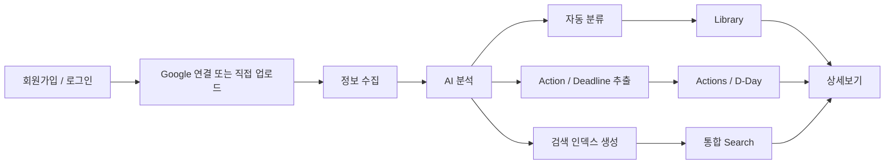
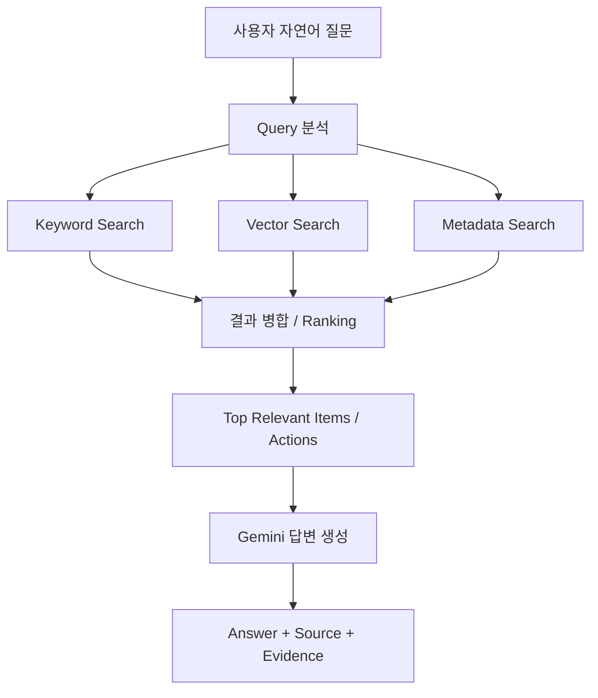
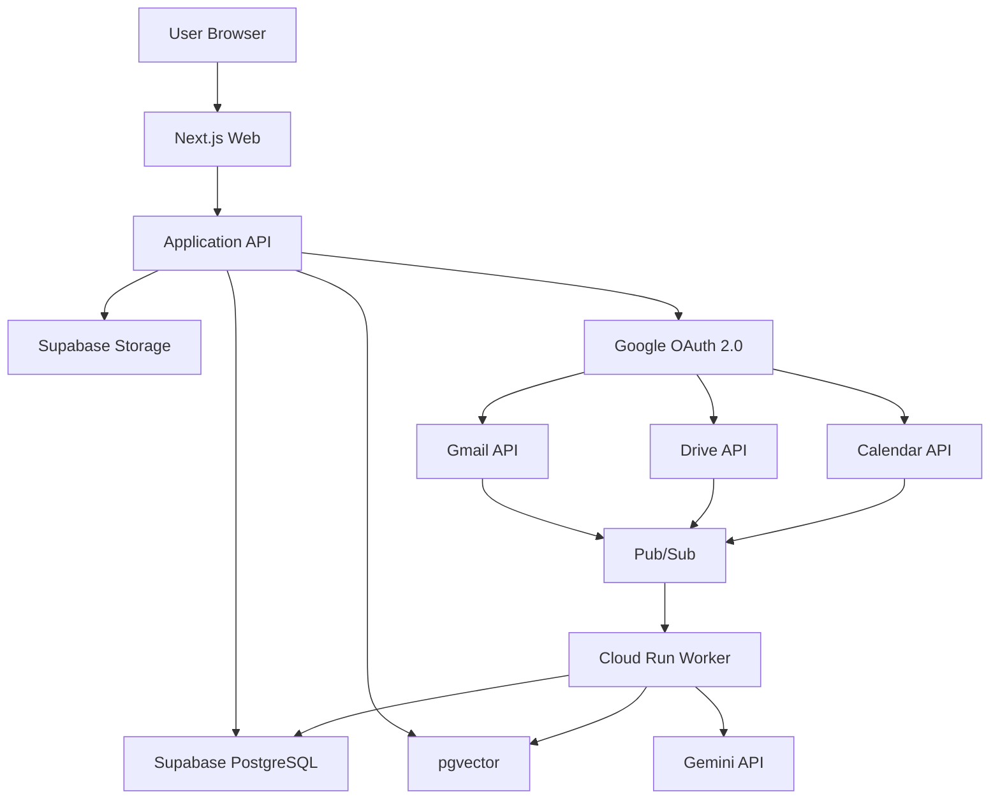
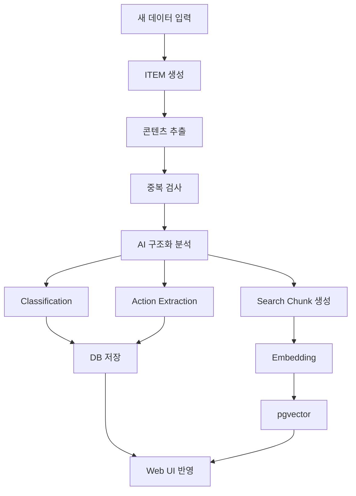

# AI 통합 정보 허브 — 개발 명세서

> 문서명: `SPEC.md`  
> 기준본: Notion 「AI 통합 정보 허브 — 서비스 기획 및 개발 기준서 v0.5」  
> 문서 목적: Codex 및 개발자가 실제 구현 시 참고하는 저장소 내 상세 명세  
> 상태: v0.1

---

## 1. 문서 목적

이 문서는 AI 통합 정보 허브의 실제 개발 기준을 저장소 안에서 확인할 수 있도록 정리한 개발 명세다.

제품의 최상위 기준은 Notion의 「AI 통합 정보 허브 — 서비스 기획 및 개발 기준서 v0.5」이며, 이 문서는 해당 기준을 개발용으로 구조화한 문서다.

### 우선순위

1. Notion 「AI 통합 정보 허브 — 서비스 기획 및 개발 기준서 v0.5」
2. `SPEC.md`
3. `README.md`
4. 실제 구현 코드

코드 구현이 문서와 다르다는 이유로 문서를 임의 수정하지 않는다.

기준 변경이 필요한 경우 기존 기준과 변경안을 비교한 뒤 명시적으로 승인된 내용만 반영한다.

---

# 2. 서비스 정의

AI 통합 정보 허브는 Gmail, Google Drive, Google Calendar와 사용자가 직접 올린 PDF, 이미지, 스크린샷, 문서, 텍스트 등의 정보를 한곳에 모아 AI가 자동 분류하고 통합 검색하며, 문서 속 해야 할 일과 마감일을 찾아 D-Day로 관리해주는 개인 AI 정보 허브다.

---

# 3. 해결하려는 문제

1. 메일, 파일, 일정, 캡처가 서로 다른 서비스에 흩어져 있다.
2. 파일명이나 메일 제목을 정확히 기억하지 못하면 다시 찾기 어렵다.
3. 공고문이나 메일을 읽어도 신청, 제출, 납부, 갱신 같은 실제 행동을 놓칠 수 있다.
4. 사용자가 직접 파일을 분류하고 마감일을 정리해야 한다.

---

# 4. 핵심 가치

## 4.1 COLLECT

정보를 모은다.

### 자동수집

- Gmail
- Google Drive
- Google Calendar

### 직접입력

- PDF
- 이미지
- 스크린샷
- 일반 문서
- 텍스트
- 클립보드 붙여넣기

---

## 4.2 FIND

AI가 분류하고 찾아준다.

- AI 자동분류
- Keyword Search
- Vector Search
- Metadata Search
- 자연어 통합검색
- Answer + Source + Evidence
- 관련 정보가 없으면 추측하지 않음

---

## 4.3 ACT

해야 할 일을 놓치지 않게 한다.

- Action 추출
- Deadline 추출
- Requirements 추출
- Conditions 추출
- D-Day 관리
- Source / Evidence 연결
- 동일 Action 중복 병합
- 마감일 변경 처리

---

# 5. v1 Scope

## 5.1 포함 범위

- Gmail 자동수집
- Google Drive 자동수집
- Google Calendar 자동수집
- PDF 직접 업로드
- 이미지 직접 업로드
- 스크린샷 직접 업로드
- 일반 문서 입력
- 텍스트 입력
- 클립보드 붙여넣기
- AI 자동분류
- 자연어 통합검색
- Action 추출
- Deadline 추출
- D-Day 관리
- Source 표시
- Evidence 표시
- 사용자 AI 분류 수정
- Google 연결 해제 및 재연결
- 데이터 삭제 관리

---

## 5.2 v1 제외 범위

다음 기능은 v1에서 개발하지 않는다.

- SMS 자동수집
- 카카오톡 자동수집
- 네이버메일 자동연동
- Outlook 자동연동
- 파일의 실제 폴더 자동이동
- 자동 신청
- 자동 제출
- 자동 결제
- 복잡한 Life Graph 시각화
- 네이티브 모바일 앱

---

# 6. 사용자 흐름



---

# 7. Unified ITEM

## 7.1 핵심 원칙

입력 경로가 달라도 시스템 내부에서는 모두 하나의 정보 단위인 **Unified ITEM**으로 처리한다.

```text
Gmail ───────────┐
Google Drive ────┤
Google Calendar ─┤
PDF ─────────────┤
Image ───────────┤──> Unified ITEM
Screenshot ──────┤
Document ────────┤
Text ────────────┘
```

Gmail, Drive, Calendar별 독립 데이터 모델을 중심 구조로 만들지 않는다.

---

## 7.2 ITEM 기본 필드

현재 기준 필드:

```text
id
user_id
source
format
external_id
title
original_url
storage_path
content_text
content_hash
processing_status
created_at
updated_at
```

DB Migration 단계에서 타입, 제약조건, FK, 인덱스, nullable 여부를 확정한다.

---

# 8. AI Classification

## 8.1 분류 구조

| 분류 | 의미 | 예시 |
|---|---|---|
| Source | 유입 경로 | Gmail |
| Format | 데이터 형태 | PDF |
| Topic | 핵심 주제 | 장학금 |
| Document Type | 자료 성격 | 공지·안내 |
| Tags | 세부 키워드 | 학교, 재학생, 등록금 |

---

## 8.2 Topic 규칙

1. Primary Topic은 기본적으로 1개를 둔다.
2. 기존 Topic과 유사하면 기존 Topic을 재사용한다.
3. 유사 Topic이 무한정 늘어나지 않도록 한다.
4. 사용자가 수정할 수 있다.
5. 사용자가 수정한 값은 AI 재분석보다 우선한다.

---

## 8.3 Document Type v1

- 공지·안내
- 신청·접수
- 계약·약관
- 결제·청구
- 예약·확인
- 증명·제출서류
- 일정·초대
- 일반자료
- 기타

---

# 9. Action / D-Day

## 9.1 Action 생성 기준

**날짜가 있다는 이유만으로 Action을 생성하지 않는다.**

사용자가 실제로 해야 하거나 선택해야 하는 행동이 있을 때만 Action을 생성한다.

---

## 9.2 Action Type

| Type | 의미 | 예시 |
|---|---|---|
| `required` | 반드시 해야 하는 일 | 서류 제출, 납부 |
| `optional` | 신청·선택 | 장학금 신청 |
| `check` | 조건 확인 필요 | 대상자 여부 확인 |

---

## 9.3 D-Day 생성 기준

1. 명확한 마감일이 있는 경우에만 생성한다.
2. 날짜를 추측하지 않는다.
3. 불명확하면 `마감일 확인 필요`로 표시한다.
4. 행사 날짜와 신청 마감일을 분리한다.
5. 신청 시작일과 마감일을 분리한다.

표시 예:

```text
D-7
D-1
D-DAY
기한 초과 +2일
마감일 확인 필요
```

---

## 9.4 중복 Action

동일 안내가 Gmail, Drive, Upload 등 여러 Source에서 반복 발견되더라도 Action은 1개만 유지한다.

```text
Action 1개
   ├─ Gmail Source
   ├─ Drive Source
   └─ Upload Source
```

즉:

```text
1 Action : N Sources
```

구조를 사용한다.

---

## 9.5 마감일 변경

마감일이 연장되면:

- 기존 Action 유지
- Deadline 갱신
- 새 Source 연결
- 변경 이력 추가

새 Action을 무조건 생성하지 않는다.

---

## 9.6 날짜 충돌

출처 간 날짜가 충돌할 경우:

- 최신 공지임이 명확하면 최신 기준 적용 가능
- 최신성이 명확하지 않으면 AI가 임의 선택하지 않음
- `마감일 확인 필요` 상태로 처리

---

# 10. Search

## 10.1 검색 대상

- Gmail 제목
- Gmail 본문
- Gmail 발신자
- Drive 파일명
- Drive 파일 내용
- 업로드 파일 내용
- 이미지 분석 내용
- 캡처 분석 내용
- Calendar 제목
- Calendar 설명
- Calendar 날짜
- Action 제목
- Action 마감일
- Action Requirements

---

## 10.2 검색 방식

검색은 다음을 결합한다.

```text
Keyword Search
+
Vector Search
+
Metadata Search
```

검색 흐름:



---

## 10.3 검색 결과 원칙

검색 결과는 다음 요소를 고려한다.

1. 질문과의 관련도
2. 날짜 조건 일치도
3. Source 조건 일치도
4. Format 조건 일치도
5. Action / Deadline 중요도
6. 최신성

세부 Ranking 가중치는 아직 미확정이다.

---

## 10.4 AI 검색 답변 원칙

AI가 답변을 생성하면 가능한 경우 반드시 아래 구조를 사용한다.

```text
Answer
Source
Evidence
```

근거가 없는 경우 답변을 추측하지 않는다.

---

# 11. 데이터 처리 정책

## 11.1 직접 업로드

직접 업로드한 파일은 Supabase Storage에 원본을 저장한다.

별도로 다음 데이터를 관리한다.

- 추출 콘텐츠
- AI Metadata
- Search Index
- Embedding
- Action
- Evidence

---

## 11.2 Google 데이터

Google 원본은 Google에 유지한다.

서비스에는 검색, 분류, Action 생성에 필요한 데이터만 저장한다.

Google 원본 데이터:

- Gmail
- Google Drive
- Google Calendar

서비스에서 분석 데이터를 삭제하더라도 Google 원본은 삭제하지 않는다.

---

## 11.3 Google 연결 해제

연결 해제 시:

- 신규 동기화 중단
- 기존 분석 데이터 유지
- 기존 검색 유지
- 기존 Action 유지
- 기존 D-Day 유지
- 재연결 시 동기화 재개

---

## 11.4 데이터 삭제

Settings > Data Management에서 다음 기능을 제공한다.

- 업로드 파일 전체 삭제
- Google 분석 데이터 삭제
- 모든 서비스 데이터 삭제

Google 원본은 삭제하지 않는다.

---

# 12. 시스템 아키텍처



---

# 13. 기술 스택

| 영역 | 기술 |
|---|---|
| Frontend | Next.js + TypeScript |
| UI | Tailwind CSS + shadcn/ui |
| Database | Supabase PostgreSQL |
| Storage | Supabase Storage |
| Vector Search | pgvector |
| Authentication | Supabase Auth |
| Google Auth | Google OAuth 2.0 |
| Google Integration | Gmail / Drive / Calendar API |
| AI | Gemini API |
| Embedding | Gemini Embedding |
| Worker | Google Cloud Run |
| Event | Google Cloud Pub/Sub / Webhook |
| Deploy | Vercel |

기술스택은 명시적 변경 승인 없이 교체하지 않는다.

---

# 14. AI 처리 파이프라인



---

## 14.1 Processing Status

```text
uploaded
↓
queued
↓
extracting
↓
analyzing
↓
indexing
↓
completed
```

실패 시:

```text
failed → retry
```

---

## 14.2 AI 결과 검증

1. 날짜 근거 없음 → D-Day 확정 금지
2. 행동 요구 없음 → Action 생성 금지
3. 대상 불명확 → `check`
4. 기존 Action과 유사 → 병합 검토
5. 기존 Topic과 유사 → 기존 Topic 사용
6. 사용자 수정값 → AI 결과보다 우선

---

# 15. 핵심 데이터베이스 구조

현재 기준 핵심 테이블:

| 테이블 | 역할 |
|---|---|
| `users` | 사용자 |
| `connections` | Google 등 외부서비스 연결 |
| `items` | 모든 정보의 기본 단위 |
| `classifications` | Topic / Document Type / Tags |
| `actions` | 해야 할 일 / D-Day |
| `action_sources` | Action과 원문 Source/Evidence 연결 |
| `search_chunks` | 검색용 Chunk + Embedding |

실제 Column, Enum, FK, RLS, Index, pgvector 설정은 DB Migration 단계에서 확정한다.

---

# 16. 화면 구조

## 16.1 공통 Web Shell

Desktop 기본 구조:

```text
┌─────────────────────────────────────────────────────────────┐
│ AI HUB       [ Global Search ..................... ]  + Add │
├──────────────┬──────────────────────────────────────────────┤
│ Home         │                                              │
│ Library      │                                              │
│ Search       │                 Main Content                 │
│ Actions      │                                              │
│              │                                              │
│ Settings     │                                              │
└──────────────┴──────────────────────────────────────────────┘
```

### Global Search

전체 서비스에서 사용할 수 있는 통합 검색창을 상단에 둔다.

### + Add

직접입력 전용이다.

- PDF / 문서 업로드
- 이미지 / 스크린샷 업로드
- Drag & Drop
- 텍스트 / Clipboard 붙여넣기

Gmail, Drive, Calendar 데이터는 `+ Add`가 아니라 연결 및 동기화를 통해 수집한다.

---

# 17. HOME

목적:

**오늘 사용자가 확인하거나 처리해야 하는 정보를 먼저 보여주는 화면**

우선순위:

```text
통합검색
↓
가까운 D-Day
↓
확인 필요
↓
최근 ITEM
```

포함 요소:

- 통합 검색창
- MY ACTIONS
- 가까운 D-Day
- 확인 필요 Action
- 최근 추가 정보

단순 통계 Dashboard보다 실제 행동 우선 구조를 사용한다.

---

# 18. LIBRARY

목적:

Unified ITEM 전체 조회 및 분류 상태 확인.

필터:

- Source
- Format
- Topic
- Document Type
- 날짜

Gmail, Drive, Calendar, Upload 데이터를 별도 메뉴로 분리하지 않는다.

Source 차이는 Badge 등 UI 표현으로 구분한다.

예:

```text
[Gmail]
[Drive]
[Calendar]
[Upload]
```

---

# 19. SEARCH

Search는 챗봇 중심 UI로 만들지 않는다.

기본 구조:

```text
사용자 질문
↓
AI Answer
↓
Source
↓
Evidence
↓
관련 ITEM / Action
```

검색 결과에는:

- 관련 ITEM
- 관련 Action
- Source
- Evidence
- 관련도 정보

를 표시할 수 있다.

AI가 확정할 수 없는 내용은 확정형 문장으로 생성하지 않는다.

---

# 20. ACTIONS

기본 필터:

- 전체
- 해야 할 일
- 신청·선택
- 확인 필요
- 완료

UI 표시명:

```text
required → 해야 할 일
optional → 신청·선택
check → 확인 필요
```

Action 카드에는 다음 정보를 표시할 수 있다.

- Action 제목
- Action Type
- Deadline
- D-Day
- Source 수
- 상태

---

# 21. DETAIL

Desktop은 2단 구조를 기본으로 한다.

```text
Original Preview | AI Analysis
```

AI Analysis에는 다음을 표시한다.

- Topic
- Document Type
- Tags
- Action
- Deadline
- Requirements
- Conditions
- Evidence

사용자는 AI 분류값을 수정할 수 있다.

사용자가 수정한 값은 `User Edited` 상태로 관리하고 자동 재분석으로 덮어쓰지 않는다.

---

# 22. SETTINGS / CONNECTIONS

포함 기능:

- Google 연결 상태
- Google 재연결
- Google 연결 해제
- 데이터 관리
- 업로드 파일 전체 삭제
- Google 분석 데이터 삭제
- 모든 서비스 데이터 삭제

Google 연결을 해제하더라도 기존 분석 데이터와 Action은 유지한다.

---

# 23. Responsive UI

v1은 네이티브 모바일 앱이 아니라 반응형 Web이다.

Desktop:

```text
Sidebar + Main
```

Mobile:

```text
Main
↓
Bottom Navigation
```

Detail 모바일 순서:

```text
Original Preview
↓
AI Metadata
↓
Action
↓
Evidence
```

---

# 24. URL Structure

예정 Route:

```text
/
├─ /login
├─ /library
├─ /search
│  └─ ?q=
├─ /actions
├─ /items/[itemId]
└─ /settings
   ├─ /connections
   └─ /data
```

실제 Next.js 구현 시 Route 구조가 변경될 필요가 있다면 기존 기준과 차이를 먼저 명시한다.

---

# 25. 개발 단계

## Phase 0 — 프로젝트 기본 세팅

- [ ] Git Repository
- [ ] Next.js + TypeScript
- [ ] Tailwind CSS + shadcn/ui
- [ ] Supabase 프로젝트
- [ ] Google Cloud 프로젝트
- [ ] Dev / Production 환경 분리

---

## Phase 1 — 로그인 + Web Shell

- [ ] 회원가입 / 로그인
- [ ] Sidebar
- [ ] Home
- [ ] Library
- [ ] Search
- [ ] Actions
- [ ] Settings
- [ ] + Add

---

## Phase 2 — 직접 업로드

- [ ] PDF Upload
- [ ] 이미지 Upload
- [ ] Screenshot Upload
- [ ] Drag & Drop
- [ ] Clipboard Paste
- [ ] Supabase Storage 저장
- [ ] ITEM 생성

---

## Phase 3 — AI 분석

- [ ] 콘텐츠 추출
- [ ] 이미지/PDF 이해
- [ ] Structured Output
- [ ] Topic
- [ ] Document Type
- [ ] Tags
- [ ] Search Chunk
- [ ] Embedding

---

## Phase 4 — Library / Detail

- [ ] ITEM 리스트
- [ ] Filter
- [ ] 원본 미리보기
- [ ] AI Metadata
- [ ] 사용자 수정

---

## Phase 5 — Action / D-Day

- [ ] Action 추출
- [ ] Deadline 추출
- [ ] Requirements 추출
- [ ] Conditions 추출
- [ ] Evidence 저장
- [ ] D-Day 계산
- [ ] 중복 Action 처리
- [ ] 수정 공지 처리

---

## Phase 6 — 통합 검색

- [ ] Full Text Search
- [ ] pgvector
- [ ] Metadata Filter
- [ ] Hybrid Ranking
- [ ] Answer + Source + Evidence

---

## Phase 7 — Google 연결

- [ ] Google OAuth
- [ ] Gmail 초기 동기화
- [ ] Drive 초기 동기화
- [ ] Calendar 초기 동기화
- [ ] Unified ITEM 변환

---

## Phase 8 — 자동 동기화

- [ ] Gmail 변경 감지
- [ ] Drive 변경 감지
- [ ] Calendar 변경 감지
- [ ] Background Worker
- [ ] 재분석
- [ ] Action 갱신
- [ ] 검색 인덱스 갱신

---

## Phase 9 — Settings / Data Management

- [ ] 연결 해제
- [ ] 재연결
- [ ] 업로드 데이터 삭제
- [ ] Google 분석 데이터 삭제
- [ ] 전체 서비스 데이터 삭제

---

## Phase 10 — 통합 QA / Demo

- [ ] PDF 테스트
- [ ] Screenshot 테스트
- [ ] Gmail 테스트
- [ ] 중복 Action 테스트
- [ ] 마감일 변경 테스트
- [ ] 검색 테스트

---

# 26. 구현 순서

상세 설계는 다음 순서를 따른다.

```text
Wireframe
↓
DB Migration
↓
API Specification
↓
AI Structured Output
↓
Implementation
```

앞 단계가 확정되기 전에 뒷 단계의 구조를 임의 확정하지 않는다.

---

# 27. v1 완료 기준

- [ ] 파일을 올리면 자동 분석된다.
- [ ] Gmail / Drive / Calendar가 동일한 ITEM 구조로 들어온다.
- [ ] AI 분류 결과를 웹에서 확인할 수 있다.
- [ ] 사용자가 잘못된 분류를 수정할 수 있다.
- [ ] 사용자 수정값은 AI 재분석으로 덮어쓰지 않는다.
- [ ] 메일 / 문서에서 실제 Action을 추출한다.
- [ ] 명확한 마감일을 D-Day로 표시한다.
- [ ] Action마다 Source / Evidence가 있다.
- [ ] 자연어로 메일, 파일, 일정, Action을 함께 검색할 수 있다.
- [ ] Google 연결 해제 후 기존 데이터가 유지된다.
- [ ] Settings에서 데이터를 삭제할 수 있다.

---

# 28. 개발 원칙

1. AI 챗봇처럼 만들지 않는다.
2. 파일을 실제로 이동시키지 않는다.
3. Deadline, 제출 의무, 적용조건은 Evidence를 가져야 한다.
4. User Edited 값은 자동 재분석으로 덮어쓰지 않는다.
5. 모든 ITEM과 Action은 원본 Source를 추적할 수 있어야 한다.
6. 모든 입력 데이터는 Unified ITEM 구조를 따른다.
7. v1 Scope는 COLLECT · FIND · ACT에 직접 기여하는 기능만 개발한다.
8. Google 원본 데이터는 서비스에서 임의로 삭제하지 않는다.
9. AI는 날짜와 조건을 근거 없이 추측하지 않는다.

---

# 29. 현재 확정된 Wireframe 기준

현재 Wireframe v0.1 기준:

- 공통 Sidebar
- 상단 Global Search
- `+ Add`
- HOME: Action 우선
- LIBRARY: Unified ITEM 중심
- SEARCH: Answer + Source + Evidence
- ACTIONS: required / optional / check
- DETAIL: Desktop 좌우 2단
- SETTINGS: Connections + Data Management
- Mobile: Bottom Navigation
- Processing Status UI 제공

이 항목들은 기능 추가가 아니라 Notion v0.5 요구사항을 실제 화면으로 구체화한 내용이다.

---

# 30. 아직 최종 결정이 필요한 항목

다음 항목은 아직 최종 확정 전이다.

- 최종 서비스명
- DB Migration 최종 Schema
- Enum 세부 구조
- RLS 정책
- Index 구성
- pgvector 세부 설정
- Google OAuth Scope
- API Specification
- AI Structured Output Schema
- Action Validation Rule 세부안
- Search Ranking 세부 알고리즘
- 테스트 Google 계정
- 테스트 PDF / 캡처 데이터셋
- 역할 분담
- Git Branch 전략

Codex는 위 항목을 임의로 확정된 요구사항처럼 처리하지 않는다.

---

# 31. 변경 관리

새로운 기능이나 설계 변경이 발생하면 다음 순서로 처리한다.

1. Notion v0.5와 충돌 여부 확인
2. 기존 기준 확인
3. 변경 필요성 설명
4. 변경 전 / 변경 후 비교
5. 승인 후 SPEC 반영
6. 구현
7. README 또는 관련 문서 갱신이 필요한지 확인

---

# 32. 현재 개발 진행 상태

```text
[완료] 서비스 기획 및 개발 기준서 v0.5
[완료] 화면 Wireframe v0.1
[다음] DB Migration v0.1
[대기] API Specification
[대기] AI Structured Output
[대기] Implementation
```

다음 설계 작업은 **Supabase PostgreSQL DB Migration v0.1**이다.

## 33. 승인된 Implementation Phase 6A 범위 (2026-10-04)

위 32절은 초기 기획 당시의 단계 기록이다. Phase 1–5 완료 후 저장된 Gmail ITEM만 Gemini로 분석하는
Phase 6A를 구현한다. 출력 기준은 루트 AI_OUTPUT_SPEC.md / AI_OUTPUT_SCHEMA.json v0.2이며,
eventObservations를 Action과 독립적으로 items.metadata.aiAnalysis에 저장하고 schemaVersion="0.2"를 보존한다.
description은 추가하지 않는다. 기존 테이블 구조·Gmail 수집·Notion 원본은 변경하지 않는다.
승인된 persist_gmail_item_analysis 서버 전용 RPC로 Classification + Action + Evidence를 단일 transaction에
저장한다. 사용자 override와 기존 Action 완료 상태를 유지한다. 실패는 전체 rollback하며,
같은 본문·모델·버전은 재사용한다. 모호한 Action 재매칭은 자동 증식/삭제 대신 저장 오류로 처리한다.
분석 성공은 indexing 대기이며 Search/Embedding 완료가 아니다. 실제 Gmail 검증은 최대 5개 ITEM이다.
AI 생성에 전달하는 구조 스키마는 provider 지원 subset이며, 저장 전 전체 v0.2 schema·Evidence·날짜 검증은 필수다.
검색/UI 고도화/Drive/Calendar/Upload/Phase 6B는 이 범위에 포함하지 않는다.

## 34. 승인된 Implementation Phase 6B 완료 (2026-10-04)

**Phase 6B COMPLETE.** Phase 6A 저장 결과를 기존 ITEM Detail 조회 API와 TypeScript 데이터 계약에
연결했다. 6B-1은 조회 계약·타입 확정, 6B-2는 실제 조회 연결, 6B-3는 통합 검증 및 인계다.
기존 응답을 유지하며 AI/User/Effective 분류, DB Action의 requirements/conditions/시작일/마감일/
완료 상태, Source Evidence 및 독립된 eventObservations, 안전한 AIAnalysis 요약을 조회한다.
사용자 override 우선과 명시적 빈 tags를 보존한다. indexing은 검색/Embedding 대기 상태다.
상세 필드 의미와 검증 범위는 API_SPEC.md 23절, 현재 인계 상태는 docs/PROJECT_STATE.md를 따른다.

실제 개발 DB RLS principal의 읽기 전용 조회와 production 조회/GET handler adapter 검증 PASS.
미인증 production HTTP 차단 PASS. 실제 Browser OAuth/인증 cookie E2E는 재실행하지 않았고,
로그인·세션·Logout/Re-login은 기존 mock 회귀로 검증했다. 실제 override/행사 관찰값 샘플은 없으며
합성 검증 PASS와 구분한다. 실제 event-date Gmail 회귀 TODO는 Phase 6A 기록대로 유지한다.
52개 격리 테스트, typecheck/lint/build/Supabase 연결 검사/diff 검사 PASS.

이 Phase는 새로운 UI/UX, API 업무 기능, DB Schema/Migration/RLS 변경 또는 Gemini 재분석을
포함하지 않는다. AI 출력 Schema/Prompt와 기존 분석 저장 구조를 변경하지 않았다.
다음 단계의 명칭·목표·범위는 사용자 지시로 별도 확정하며, 이 완료 기록은 후속 구현 승인이 아니다.
