# 🚀 AI Hub: 개인 지식 및 업무 통합 AI 어시스턴트
> **Google Workspace(Gmail · Drive · Calendar)와 로컬 문서를 통합 수집하고, Gemini AI를 통해 일정·마감일·할 일을 스스로 분석하여 스마트 플래너 및 근거 기반 RAG 검색으로 연결하는 지능형 워크스페이스**

---

## 📌 1. 프로젝트 개요 (Overview)

* **배경 & 문제의식**: 일상과 업무 속에서 중요한 할 일과 마감 일정은 **Gmail 이메일 본문, Google Docs 기획서, 캘린더, 로컬 PDF 공문서** 등에 파편화되어 흩어져 있습니다. 사용자가 이를 매번 직접 열람하고 메모장에 옮겨 적는 비효율과 마감일 누락 문제를 해결하고자 개발되었습니다.
* **핵심 가치**:
  1. **올인원 데이터 수집**: 구글 계정 1회 연동만으로 메일, 문서, 일정을 한곳에 동기화
  2. **환각 없는(Zero-Hallucination) AI 구조화**: Gemini 모델이 본문에서 마감일과 액션을 추출하되, 원문 텍스트에 실제 존재하는 문장인지 엄격하게 오프셋 검증
  3. **스마트 플래너 & RAG 검색**: 추출된 일정이 캘린더와 플래너에 자동 배치되며, 수집된 모든 자료를 바탕으로 근거를 인용하는 지능형 질의응답 제공

---

## 🏗️ 2. 시스템 아키텍처 다이어그램 (Architecture)

> 💡 **시각화 다이어그램 파일**: 브라우저에서 바로 열 수 있는 대시보드형 다이어그램 `docs/architecture/ai-hub-architecture.html`이 함께 제공됩니다.

```mermaid
flowchart LR
    subgraph UI["🖥️ 1. 클라이언트 / 인터페이스 (Next.js 16)"]
        Dashboard["Today 대시보드<br/>(오늘의 할 일 & 캘린더)"]
        Planner["스마트 플래너 Workspace<br/>(마감일 그룹별 관리)"]
        Search["근거 기반 RAG 검색<br/>(원문 인용 질의응답)"]
        Library["통합 라이브러리<br/>(상세 탭 & AI 근거 하이라이트)"]
    end

    subgraph Ingestion["📥 2. 수집 파이프라인 (Google OAuth 2.0 & Files)"]
        Gmail["Gmail API v1<br/>(수동 100건 / 15분 Cron 수집)"]
        Drive["Google Drive / Docs<br/>(Docs 텍스트 추출 & 변경 감지)"]
        Calendar["Google Calendar<br/>(일정/마감일 분리 로드)"]
        OCR["로컬 파일 & OCR 파서<br/>(Tesseract.js / PDF.js)"]
    end

    subgraph Processing["⚡ 3. AI 구조화 & 작업 스케줄러"]
        Gemini["Gemini AI 구조화 엔진<br/>(JSON Schema Structured Outputs)"]
        Validator["Evidence 근거 검증기<br/>(Unicode 오프셋 일치 검증)"]
        Queue["비동기 작업 큐<br/>(180s Lease & 5회 지수 백오프)"]
        Scheduler["스케줄러 (pg_cron & pg_net)<br/>(단기 HMAC 서명 디스패처)"]
    end

    subgraph Database["🗄️ 4. 데이터베이스 & 보안 계층 (Supabase PostgreSQL 17)"]
        RPC["원자적 저장 프로시저 (RPC)<br/>(persist_gmail_item_analysis)"]
        Tables["Core 테이블<br/>(items, actions, action_sources)"]
        RLS["Row Level Security (RLS)<br/>(유저별 완벽한 데이터 격리)"]
        Vault["Supabase Vault<br/>(OAuth 토큰 & 암호화 키 보관)"]
    end

    UI <--> Ingestion
    Ingestion --> Database
    Database <--> Processing
    Processing --> Database
    Database --> UI
```

---

## 🛠️ 3. 기술 스택 및 선정이유 (Tech Stack)

| 구분 | 사용 기술 | 선정이유 및 역할 |
| :--- | :--- | :--- |
| **Frontend** | **Next.js 16 (App Router)**, React 19, Tailwind CSS | 최신 Turbopack을 통한 빠른 빌드 속도, 서버 컴포넌트(RSC)를 활용한 초기 로딩 최적화 및 SEO/반응형 UI 구현 |
| **Language** | **TypeScript 5** | 복잡한 AI JSON 출력 스키마와 데이터베이스 엔터티 간의 타입 안정성 보장 및 런타임 에러 방지 |
| **Backend / DB** | **Supabase (PostgreSQL 17)** | 서버리스 환경에 최적화된 BaaS. RLS(Row Level Security)를 통한 강력한 유저 격리 및 `pg_cron`, `pg_net` 내장 활용 |
| **AI Model** | **Google Gemini 1.5 / Flash** | 초당 처리 속도(Throughput)가 빠르고 비용 효율적이며, 엄격한 **Structured Outputs (JSON Schema)** 강제 기능 제공 |
| **Client OCR** | **Tesseract.js (WASM), PDF.js** | 무거운 파일 변환 및 OCR 작업을 브라우저(클라이언트) 리소스로 처리하여 서버 부하 및 외부 API 비용 0원화 |
| **Infra & Deploy** | **Vercel Production** | Edge Network 기반의 빠른 글로벌 라우팅, 서버리스 함수(Serverless Functions), 무중단 자동 배포 환경 |

---

## ⚙️ 4. 어떻게 만들었는가? 핵심 구현 원리 (How It Was Built)

### ① 다중 소스 통합 수집 파이프라인 (Data Ingestion)
* **Google OAuth 2.0 토큰 수명주기 관리**: Refresh Token을 DB의 `vault.decrypted_secrets` 및 암호화 필드로 안전하게 보관하며, 토큰 만료 1분 전 백그라운드에서 자동으로 토큰 갱신(`refreshGoogleAccessToken`).
* **Gmail 지능형 스캔**: `in:inbox newer_than:30d` 필터로 최근 메일 최대 100건을 고속 조회하며, `external_id`와 본문 해시(`content_hash`)를 비교해 변경된 메일만 업데이트(Upsert).
* **Calendar 및 Drive 변경 감지**: Google Docs의 `modifiedTime`과 `driveTarget`을 대조하여 수정된 문서만 선택 수집하고, 캘린더는 일정(Event)과 사용자의 행동 마감(Deadline)을 명확히 구분하여 적재.

### ② 환각 없는(Zero-Hallucination) AI 구조화 엔진
* **엄격한 JSON Schema 강제**: Gemini API 호출 시 `AI_OUTPUT_SCHEMA`를 시스템 프롬프트 및 스키마로 강제하여 `classification(분류)`, `actions(할 일 목록)`, `startObservation(시작일)`, `deadlineObservation(마감일)` 구조로만 응답 생성.
* **Evidence 오프셋 검증기 (`validateAnalysis`)**:
  * AI가 생성한 할 일마다 반드시 메일/문서 원문에서 발췌한 **직접 인용문(`evidence.text`)**을 포함하도록 강제.
  * 서버에서 원문 텍스트 내 실제 시작/끝 글자 위치(`startChar`, `endChar`)를 유니코드 코드 포인트(Unicode Code Point) 단위로 역추적하여, **단 한 글자라도 원문에 없거나 왜곡된 경우 저장을 즉시 거부**하여 환각을 100% 방지.

### ③ 트랜잭션 무결성을 보장하는 원자적 저장 프로시저 (RPC)
* AI 분석이 완료되면 `persist_gmail_item_analysis` PL/pgSQL 프로시저를 1회 호출.
* 단일 DB 트랜잭션 안에서:
  1. 원문 변경 여부 재확인 (`CAS 낙관적 락`)
  2. 메타데이터에 AI 분석 결과 저장
  3. `public.actions`(할 일) 생성 또는 기존 할 일과 매칭 재사용
  4. `public.action_sources`(인용 근거) 링크 생성
  5. `public.classifications`(문서 주제/타입) 자동 분류
* 중간에 오류가 발생하면 롤백되어 데이터 불일치(Orphan Data)를 원천 차단.

### ④ 비동기 작업 큐 & 지수 백오프 스케줄러 (Queue System)
* **Lease 기반 분산 잠금**: 백그라운드 워커가 작업을 꺼내갈 때 180초간 임대(Lease) 토큰을 부여하여 중복 실행 방지.
* **지수 백오프(Exponential Backoff)**: 일시적 네트워크 장애나 Gemini API 429(Rate Limit) 발생 시 최대 5회까지 지수적으로 대기 시간을 늘려가며 자동 재시도.
* **스케줄러 보안**: Supabase의 `pg_cron`이 Vercel 엔드포인트를 호출할 때, 2분간만 유효한 HMAC-SHA256 단기 서명 헤더를 첨부하여 무단 호출 방지.

### ⑤ 근거 기반 RAG 통합 검색 (Evidence-grounded Search)
* 사용자가 질문을 입력하면 수집된 이메일과 문서에서 연관 문단을 검색하고, 질문에 대한 답변과 함께 **답변의 근거가 된 원본 메일 링크와 인용문**을 사용자에게 함께 제공.

### ⑥ 다중 사용자(Multi-User) 확장 아키텍처
* RLS(Row Level Security)를 통해 모든 유저의 데이터가 완벽하게 격리되며, 어떤 구글 계정으로 로그인하든 동기화 즉시 AI 분석을 받아 자신의 대시보드와 플래너를 독립적으로 구성할 수 있도록 설계.

---

## 📈 5. 기술적 도전 과제 및 트러블슈팅 (Troubleshooting)

### Q1. Gemini 무료 티어의 429 Rate Limit 및 비용 제약
* **문제**: 사용자가 메일 100건을 한 번에 동기화하면 Gemini API 요청이 몰려 즉시 429 에러 발생.
* **해결**: 동기화 직후에는 미분석 아이템 중 최신 3건을 우선적으로 직접 분석(`runBoundedAnalysis`)하고, 나머지는 백그라운드 대기열(`gmail_analysis_jobs`)에 안전하게 등록하여 순차 소비하도록 처리 분리.

### Q2. 비동기 작업 중단 및 고아(Stale) 상태 해결
* **문제**: Vercel Serverless 함수의 실행 시간 초과나 네트워크 단절로 인해 작업이 `analyzing` 상태로 영구 고착되는 현상.
* **해결**: 180초 Lease 타임아웃 검증 로직과 `etc-gmail-lease-<item-id>` 자동 회수 스케줄러(`expire_gmail_analysis_lease`)를 구축하여 중단된 작업을 자동으로 `retry` 상태로 복구.

### Q3. AI 모델의 날짜 및 마감일 착각 문제
* **문제**: 메일 본문에 "이번 주 금요일까지 제출"처럼 연도와 절대 날짜가 없는 상대적 표현이 포함된 경우 연도를 잘못 추론하는 현상.
* **해결**: 메일 발송 시점의 절대 타임스탬프(`source_created_at`)를 AI 프롬프트에 `AnalysisDateContext`로 주입하고, 애매한 날짜는 확정하지 않고 `needs_review` 상태로 마킹하여 사용자가 플래너에서 직접 검토할 수 있도록 UI 유도.

---

## 🎯 6. 향후 발전 과제 (Roadmap)
1. **Slack / Notion 양방향 웹훅 연동**: 슬랙 메시지 및 노션 페이지 변경사항 자동 동기화
2. **다중 사용자 백그라운드 Cron 라운드로빈**: 가입된 모든 유저를 주기적으로 순회하는 분산 크론 고도화
3. **온디바이스 경량 LLM(WebLLM) 모드**: 민감 정보의 경우 로컬 브라우저 내부에서 분석하는 제로 프라이버시 모드 지원
